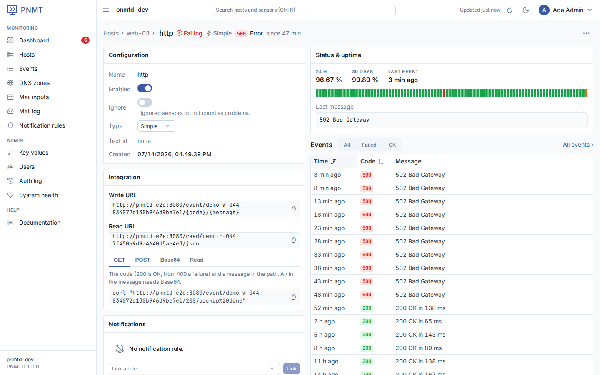
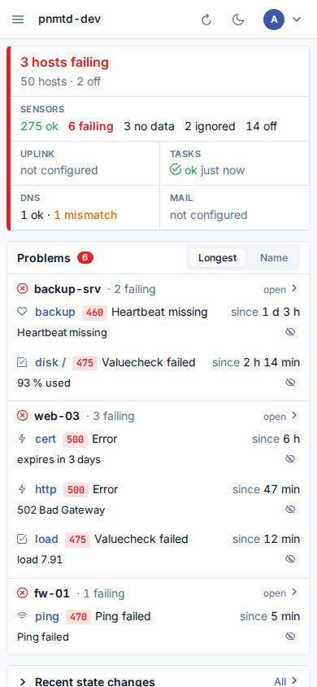

# PNMTD - Personal Network Monitoring Tool

A monitoring application to keep an eye on hosts, e-mails and DNS zones. Useful for additional oversight of main monitoring systems.

 [](https://hub.docker.com/r/uisach/pnmtd)


# ⭐ Features

- **Sensors** grouped in hosts:
  - scripts and devices report over plain HTTP (`/event/<token>/<code>/<message>`);
  - heartbeats that must arrive in time;
  - ping checks;
  - value checks with regular expressions;
  - several values in one JSON report;
  - timespan conditions such as "one success daily at 8".
- **IoT nodes over UDP** (PNMT-UDP, port 5028/udp): a signed heartbeat in 9 bytes, signatures from a static token to HMAC (SHA-256, SHA-1, MD5) and AES-CMAC, AES-CCM encryption, commands delivered with the node's next packet, firmware updates from an uploaded `.bin`, and the protocol documented with live examples in the UI.
- **MikroTik routers** (RouterOS 7.13 or later): status and events from a read-only user that one pasted script creates, configuration backups with diffs (on a schedule of their own or off, and optionally encrypted one way with an age key that never reaches PNMT), updates (download and reboot, or RouterOS's own install), and remote commands, over SSH or through PNMT's own WireGuard tunnel for routers behind NAT. MikroTik's release feed is read hourly: a router behind a release that fixes a critical security issue raises an alert. The router admin's password is typed only for an update or a command run as the admin, and never stored. Custom WireGuard tunnels give technicians WinBox and SSH to the routers.
- **Windows servers and PCs** (Server 2016–2025, Windows 10 Pro and 11): one executable, joined with a token from the UI, reports over a WebSocket on PNMT's own port (nothing to open): the system, hardware and network in detail, services by who signed them, every way in (RDP, WinRM, SMB, SSH, remote tools …) with the firewall, every admin login and the failed ones, the event log's errors, and readable changes. **Diagnostics** (ping and DNS sets) run on the servers on a schedule or by hand, each assignment a sensor of its own. **PowerShell scripts** from PNMT run only where a local administrator allowed them, as accounts whose passwords never reach PNMT or are encrypted to the server.
- **Linux servers** (Debian 12 and 13; Proxmox VE and Ubuntu LTS too): one binary, installed with one line copied from PNMT (downloaded from PNMT itself and checked by its SHA-256), a systemd service with a command line: the same reports in Linux terms (updates, services with timers and cron, sshd and every other way in, logins and sudo from the journal, the journal's errors), and **every `authorized_keys` file**, watched within seconds. **The SSH key manager** names each key and assigns it to a user, so PNMT shows whose key let whom in, raises an event for a key nobody registered, and removes a departing colleague's keys from every server in one step, where the server's own `/etc/pnmt-agent/config.yaml` allows it. **Bash scripts** run there as named accounts, likewise only where root allowed them.
- **SSL certificates:** a sensor reads the certificate of any `host:port` and stores everything it says (names, issuer, key, fingerprints, extensions, the chain); it fails days before expiry and once expired, and, where a sensor says so, when the certificate, its key or its issuer changes, until a person accepts the change in a warning dialog. Public CAs, private CAs added in PNMT, and self-signed certificates pinned on first sight. PNMT reads only what the server sends: it never fetches a URL a certificate names.
- **Advanced sensors:** an app, a script or a service POSTs any JSON object (up to 256 KiB) with the sensor's token, as often as it likes. PNMT shows it readably with no setup (lists of objects as tables, times in your zone, health words coloured), keeps a history with a comparison, and charts the values a person picks. **Rules** decide whether all is well, without code: `disk.free_gb` at least 5, none of `jobs[*].state` is `failed`, `backup.finished` newer than 26 h, the app's own `status` healthy. The IETF health format, Spring Boot's and ASP.NET's health endpoints work as they are. One evaluator judges every report in order and writes an event only when the verdict changes; a silent app fails after its interval.
- **3rd Party Connectors:** an outside system (a shop's back office, a ticketing system, a scheduler) runs one script, or one function in it, on one server, with `POST /connector/v1/<slug>` and its key:
  - the admin exposes or fixes each argument, with patterns that must match the whole value;
  - the caller waits for the outcome or takes a ticket;
  - each caller has one key, which can be shown again, and the networks it may call from;
  - the typesafe model can review every call against the connector's purpose and the admin's own questions;
  - calls are queued, one run per script and server at a time;
  - *Calls* shows every call with its arguments, review, run and output.

  The server's own policy stays final.
- **E-mail input:** reports from other tools (Synology HyperBackup, Veeam, Zabbix, …) become sensor events, matched by sender, subject and body; a rule can also ignore or delete mails.
- **DNS zone monitoring:** a zone file is the reference, and every record is compared with what the resolvers answer.
- **Locations and a knowledge base:** locations nest (a site, its rooms, a rack) and gather their hosts, with the fields an Admin defines (Markdown above all, inherited by sub-locations or marked sensitive) on a page of their own. Knowledge base pages (`KB-42`) have tags, a status and an edit history with diffs, link to locations, hosts and sensors, and are found by the global search and a full-text search. One editor for both: a visual one and VS Code's behind a switch, images and files pasted in, Mermaid diagrams and charts. AI suggests tags only for pages a person declared free of credentials and personal data, and a page marked sensitive never reaches it. Pages link to each other, mutually; the newest changes of two weeks are on top; people like pages and record that a page solved their problem, and its authors hear of it by e-mail if they want; a page says when it was written mostly with AI; and a map shows how pages, locations, hosts and sensors are connected. The files lie in a folder on the Docker host, and in the backups.
- **Responsibilities:** who owns which area of work, with a responsible and a deputy, a long description written as a knowledge base page is, and links to pages, locations and hosts, which then show them; a global responsible and deputy for what nothing covers; with Redmine, the projects and trackers each person handles. A colour each and a list sorted by any column; a *Links* tab with every link, the hosts and locations nobody owns, and many links changed at once; an *Overview* that draws them on a map with their people and what they link, arranged by hand or with *Arrange* (a circle, clusters, a grid) for everyone, with notes. An escalation order for each: responsible, deputy, global responsible, global deputy, the next moving up for whoever is missing; the map's lines go to the first, the second or both. Information only; read over MCP and by Cookie, and over MCP everything *Responsibilities: Edit* changes on the page, the colour as hex, the history, the Links tab and the notes included.
- **Boards:** monitoring dashboards for a wall, at a URL of their own under `/pnmt-board/`, which a reverse proxy can pass without the admin UI (or the other way round). A board opens without sign-in from the IPv4 and IPv6 networks it names, and for signed-in users from anywhere. It has 1 to 4 columns of elements (PNMT's failing sensors and hosts, the Redmine overview, the newest tickets and those received and solved today, Zabbix's problems and their history, the lounge, a clock, a note, who is on duty, expiring certificates …), fits the window or scrolls, and has a status bar that turns green, yellow or red by its own rules, and grey when it can't tell. Fifteen themes, picked from tiles; set up on a full page with a live preview. A large message box (alert, warning, maintenance, information, all clear) goes to one or more boards from *Admin → Debug*, or from Cookie to the boards chosen for it; elements also show a sensor's last message as large as fits, an uploaded image or animated GIF, 24- or 12-hour clocks with date formats in four languages, and who is on duty with their deputies.
- **Notifications** by e-mail, Pushover or webhook: always, on a change, on failures, or on failures and the way back to OK. Hosts and sensors have an importance; a rule can cover everything of at least one importance, or a host, with exclusions, and the Notification Manager shows what nothing covers.
- **AI, optional** (through OpenRouter, with a monthly budget): proposals for rules for mails no rule handles, ratings of RouterOS releases, and an hourly, anonymised look at the monitoring state for incidents and patterns. Every proposal waits for a person under *Decisions*, outside text is screened for prompt injection first, and every request is logged with its cost.
- **Redmine, optional:** the tickets of chosen projects in PNMT, an overview of the most important ones (urgent, unassigned, overdue, linked to a failing sensor), a search and a page per ticket, linked to hosts, sensors, locations and knowledge base pages, whose panels list them; a failing sensor shows that someone is on it. Read-only, through one API key.
- **Zabbix, optional** (6.0 or later): the open problems by severity and by host group or tag, the hosts and a page per host, and **Zabbix hosts as sensors** of PNMT's hosts: one fails from a severity up and notifies like any other sensor, attached by hand or in bulk from suggestions matched by name and address. Read-only, through an API token of a role that may call five methods.
- **PNMT's own condition** as sensors: the uplink (with its history on its own page), the AI, its budget, the RouterOS advisories, Redmine and Zabbix, notified like any other sensor.
- **The admin UI** at `/pnmt-admin/`:
  - a dashboard that answers "is anything wrong, and what exactly?" at a glance, with uptime bars for every host;
  - compact pages for everything else, in light and dark, on a phone too.
- **Users** with groups and rights (a level per area, or the admin flag), two-factor authentication (any authenticator app), lockout, and recovery scripts on the server.
- **An audit log** of every change, sign-in and refusal: who, when, from where, and each field's old and new value; a *History* tab on hosts and sensors, and a CSV export.
- **Operations:** one image, PostgreSQL, and scripts for backup, restore, update and users.

<p>
  
  
</p>

# 🔧 Self-hosting

PNMT runs as two containers, the app and PostgreSQL, from the `deploy/` folder. Docker with compose is all it needs.

```sh
git clone https://github.com/muqiuq/PNMTD.git /srv/pnmtd
cd /srv/pnmtd/deploy
./init.sh --url https://pnmt.example.com   # writes .env, shows the first admin's password once
docker compose up -d
./info.sh
```

Then sign in at `https://pnmt.example.com/pnmt-admin/` (or `http://<host>:5001/pnmt-admin/`).

- **Operation, backups, users, reverse proxies (Caddy, nginx, Traefik):** [deploy/README.md](deploy/README.md).
- **Upgrading from v0.12** (two containers, SQLite): [deploy/UPGRADING-1.0.md](deploy/UPGRADING-1.0.md). Sensor URLs, data and passwords carry over.

# 📡 Reporting to PNMT

Every sensor has a write token and a read token, which its page in the UI shows with copyable examples. No sign-in is needed: the token is the secret.

```sh
# report: a code (0–399 is success, from 400 a failure) and a message
curl "https://pnmt.example.com/event/<write token>/200/backup%20done"
curl --data "backup done, 12.4 GB" "https://pnmt.example.com/event/<write token>/200"

# read the last state: json, raw ("True;message") or property
curl "https://pnmt.example.com/read/<read token>/raw"
```

The sensor API answers exactly as it did in v0.12, which a recorded contract checks on every build. The UI's *Documentation* page lists every status code and sensor type.

An app with more to say POSTs a JSON object to an *Advanced* sensor, the token in the header ([docs/advanced-report.md](docs/advanced-report.md)); the sensor's rules decide whether it is OK:

```sh
curl -H "Authorization: Bearer <write token>" --data '{"status":"ok","disk":{"free_gb":412.5}}' https://pnmt.example.com/report
```

Devices with a radio budget report over UDP instead: a 9-byte heartbeat rather than about 1 KB of HTTP. Add a sensor of type *UDP node*; its page shows the key, ready-made packets and the protocol ([docs/udp-protocol.md](docs/udp-protocol.md)). Without a device at hand, a simulated one:

```sh
docker compose exec pnmtd pnmtd udp node --server 127.0.0.1:5028 --id 1 --key <the node's key>
echo 41 01 00 01 00 01 <token> | xxd -r -p | nc -u -w1 pnmt.example.com 5028   # a TOKEN32 heartbeat, no crypto
```

A MikroTik router is a sensor of type *MikroTik router*. Its *Setup* tab shows a join script, which the router's admin pastes into the terminal once; PNMT then logs in as `pnmt`, which may read but not change anything. Routers behind NAT dial PNMT through WireGuard (`./init.sh --wireguard`). Operation, the gateway and its port: [deploy/README.md](deploy/README.md#mikrotik-routers-and-wireguard); the design: [docs/mikrotik-plan.md](docs/mikrotik-plan.md).

The UplinkCheck setting needs a remote endpoint. [examples/digitalocean_function.py](examples/digitalocean_function.py) is one, for a [DigitalOcean Function](https://www.digitalocean.com/products/functions).

# 🛠 Development

- **Stack:** .NET 10 (`PNMTD`, `PNMTD.Lib`, and the agents: `PNMTD.Sensor.Windows` and `PNMTD.Sensor.Linux` on their shared `PNMTD.Sensor.Core`, which build on macOS and Linux too), PostgreSQL, and Vue 3 with PrimeVue (`PNMTD.WebUI`). `./build-sensor-windows.sh` and `./build-sensor-linux.sh` build the agents' executables into `dist/` (`x64` or `arm64` for one); `tools/linux-lab.sh` runs Debian and Ubuntu servers in Podman to try the Linux agent.
- **Node runs only in containers:** `tools/npm.sh` and `start.sh` use Podman by default (`ENGINE=docker` works too). Never on the host.

```sh
./start.sh                  # build and run on http://localhost:7327/pnmt-admin/ (dev.env holds the admin password)
SEED=1 ./start.sh           # …with demo data: 50 hosts, 300 sensors (5 of them MikroTik routers), locations, 20 pages
WIREGUARD=1 ./start.sh      # …with the WireGuard gateway; tools/chr-lab.sh runs MikroTik CHR routers to join
WEB=dev ./start.sh          # …plus Vite with live reload on http://localhost:5173/pnmt-admin/ (boards: :5174/pnmt-board/<token>)
./run-tests.sh              # everything: .NET, web, the sensor contract, deploy/, the v0.12 upgrade, browser tests
./stop.sh                   # stop it all (--data also offers to delete the volumes)
```

The design and its decisions are in [docs/webui-migration-plan.md](docs/webui-migration-plan.md).

# 🧸 Motivation

- I was using uptimerobot as oversight monitoring, but needed more features, especially the DNS zone monitoring.
- I needed to automatically process e-mails from secondary monitoring tools (like Synology NAS HyperBackup, Zabbix, …).
- Improve my C# skills.

If you like what we're building and want to contribute, you're warmly welcome to **join the effort**!

# License

[LICENSE](LICENSE)
