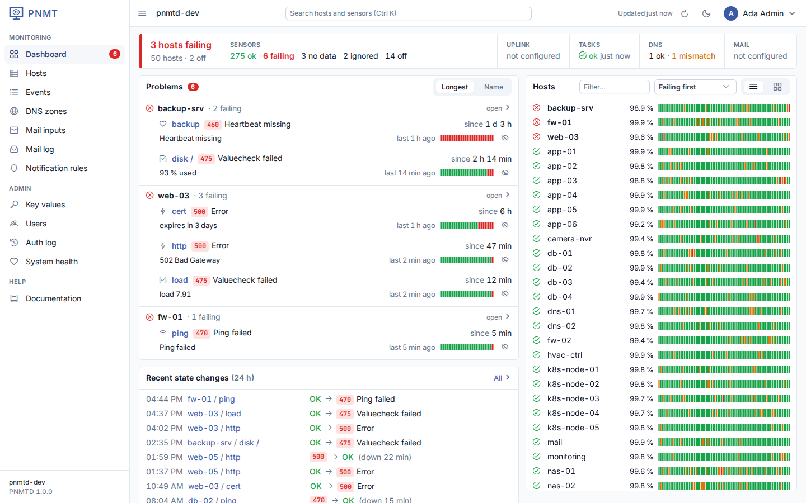

# PNMTD - Personal Network Monitoring Tool

A monitoring application to keep an eye on hosts, e-mails and DNS zones. Useful for additional oversight of main monitoring systems.

 [](https://hub.docker.com/r/uisach/pnmtd)



# ⭐ Features

- **Sensors** grouped in hosts:
  - scripts and devices report over plain HTTP (`/event/<token>/<code>/<message>`);
  - heartbeats that must arrive in time;
  - ping checks;
  - value checks with regular expressions;
  - several values in one JSON report;
  - timespan conditions such as "one success daily at 8".
- **IoT nodes over UDP** (PNMT-UDP, port 5028/udp): a signed heartbeat in 9 bytes, signatures from a static token to HMAC (SHA-256, SHA-1, MD5) and AES-CMAC, AES-CCM encryption, commands delivered with the node's next packet, firmware updates from an uploaded `.bin`, and the protocol documented with live examples in the UI.
- **MikroTik routers** (RouterOS 7.13 or later): status and events from a read-only user that one pasted script creates, configuration backups with diffs (on a schedule of their own or off, and optionally encrypted one way with an age key that never reaches PNMT), updates (download and reboot, or RouterOS's own install), and remote commands, over SSH or through PNMT's own WireGuard tunnel for routers behind NAT. MikroTik's release feed is read hourly: a router behind a release that fixes a critical security issue raises an alert. The router admin's password is typed only for an update or a command run as the admin, and never stored. Custom WireGuard tunnels give technicians WinBox and SSH to the routers.
- **Windows servers and PCs** (Server 2016–2025, Windows 10 Pro and 11): one executable, joined with a token from the UI, reports over a WebSocket on PNMT's own port (nothing to open): the system, hardware and network in detail, services by who signed them, every way in (RDP, WinRM, SMB, SSH, remote tools …) with the firewall, every admin login and the failed ones, the event log's errors, and readable changes. **Diagnostics** (ping and DNS sets) run on the servers on a schedule or by hand, each assignment a sensor of its own. **PowerShell scripts** from PNMT run only where a local administrator allowed them, as accounts whose passwords never reach PNMT or are encrypted to the server.
- **E-mail input:** reports from other tools (Synology HyperBackup, Veeam, Zabbix, …) become sensor events, matched by sender, subject and body; a rule can also ignore or delete mails.
- **DNS zone monitoring:** a zone file is the reference, and every record is compared with what the resolvers answer.
- **Notifications** by e-mail, Pushover or webhook: always, on a change, on failures, or on failures and the way back to OK. Hosts and sensors have an importance; a rule can cover everything of at least one importance, or a host, with exclusions, and the Notification Manager shows what nothing covers.
- **AI, optional** (through OpenRouter, with a monthly budget): proposals for rules for mails no rule handles, ratings of RouterOS releases, and an hourly, anonymised look at the monitoring state for incidents and patterns. Every proposal waits for a person under *Decisions*, outside text is screened for prompt injection first, and every request is logged with its cost.
- **PNMT's own condition** as sensors: the uplink (with its history on its own page), the AI, its budget and the RouterOS advisories, notified like any other sensor.
- **The admin UI** at `/pnmt-admin/`:
  - a dashboard that answers "is anything wrong, and what exactly?" at a glance, with uptime bars for every host;
  - compact pages for everything else, in light and dark, on a phone too.
- **Users** with roles (Viewer, User, Admin), two-factor authentication (any authenticator app), lockout, an audit log, and recovery scripts on the server.
- **Operations:** one image, PostgreSQL, and scripts for backup, restore, update and users.

<p>
  
  
</p>

# 🔧 Self-hosting

PNMT runs as two containers, the app and PostgreSQL, from the `deploy/` folder. Docker with compose is all it needs.

```sh
git clone https://github.com/muqiuq/PNMTD.git /srv/pnmtd
cd /srv/pnmtd/deploy
./init.sh --url https://pnmt.example.com   # writes .env, shows the first admin's password once
docker compose up -d
./info.sh
```

Then sign in at `https://pnmt.example.com/pnmt-admin/` (or `http://<host>:5001/pnmt-admin/`).

- **Operation, backups, users, reverse proxies (Caddy, nginx, Traefik):** [deploy/README.md](deploy/README.md).
- **Upgrading from v0.12** (two containers, SQLite): [deploy/UPGRADING-1.0.md](deploy/UPGRADING-1.0.md). Sensor URLs, data and passwords carry over.

# 📡 Reporting to PNMT

Every sensor has a write token and a read token, which its page in the UI shows with copyable examples. No sign-in is needed: the token is the secret.

```sh
# report: a code (0–399 is success, from 400 a failure) and a message
curl "https://pnmt.example.com/event/<write token>/200/backup%20done"
curl --data "backup done, 12.4 GB" "https://pnmt.example.com/event/<write token>/200"

# read the last state: json, raw ("True;message") or property
curl "https://pnmt.example.com/read/<read token>/raw"
```

The sensor API answers exactly as it did in v0.12, which a recorded contract checks on every build. The UI's *Documentation* page lists every status code and sensor type.

Devices with a radio budget report over UDP instead: a 9-byte heartbeat rather than about 1 KB of HTTP. Add a sensor of type *UDP node*; its page shows the key, ready-made packets and the protocol ([docs/udp-protocol.md](docs/udp-protocol.md)). Without a device at hand, a simulated one:

```sh
docker compose exec pnmtd pnmtd udp node --server 127.0.0.1:5028 --id 1 --key <the node's key>
echo 41 01 00 01 00 01 <token> | xxd -r -p | nc -u -w1 pnmt.example.com 5028   # a TOKEN32 heartbeat, no crypto
```

A MikroTik router is a sensor of type *MikroTik router*. Its *Setup* tab shows a join script, which the router's admin pastes into the terminal once; PNMT then logs in as `pnmt`, which may read but not change anything. Routers behind NAT dial PNMT through WireGuard (`./init.sh --wireguard`). Operation, the gateway and its port: [deploy/README.md](deploy/README.md#mikrotik-routers-and-wireguard); the design: [docs/mikrotik-plan.md](docs/mikrotik-plan.md).

The UplinkCheck setting needs a remote endpoint. [examples/digitalocean_function.py](examples/digitalocean_function.py) is one, for a [DigitalOcean Function](https://www.digitalocean.com/products/functions).

# 🛠 Development

- **Stack:** .NET 10 (`PNMTD`, `PNMTD.Lib`, and the Windows agent `PNMTD.Sensor.Windows`, which builds on macOS and Linux too), PostgreSQL, and Vue 3 with PrimeVue (`PNMTD.WebUI`). `./build-sensor-windows.sh` builds the agent's two executables into `dist/` (`x64` or `arm64` for one).
- **Node runs only in containers:** `tools/npm.sh` and `start.sh` use Podman by default (`ENGINE=docker` works too). Never on the host.

```sh
./start.sh                  # build and run on http://localhost:7327/pnmt-admin/ (dev.env holds the admin password)
SEED=1 ./start.sh           # …with demo data: 50 hosts, 300 sensors, 5 of them MikroTik routers
WIREGUARD=1 ./start.sh      # …with the WireGuard gateway; tools/chr-lab.sh runs MikroTik CHR routers to join
WEB=dev ./start.sh          # …plus Vite with live reload on http://localhost:5173/pnmt-admin/
./run-tests.sh              # everything: .NET, web, the sensor contract, deploy/, the v0.12 upgrade, browser tests
./stop.sh                   # stop it all (--data also offers to delete the volumes)
```

The design and its decisions are in [docs/webui-migration-plan.md](docs/webui-migration-plan.md).

# 🧸 Motivation

- I was using uptimerobot as oversight monitoring, but needed more features, especially the DNS zone monitoring.
- I needed to automatically process e-mails from secondary monitoring tools (like Synology NAS HyperBackup, Zabbix, …).
- Improve my C# skills.

If you like what we're building and want to contribute, you're warmly welcome to **join the effort**!

# License

[LICENSE](LICENSE)
