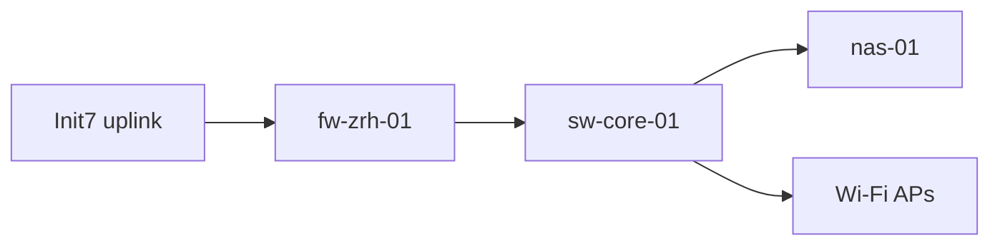

# Plan: Locations and the knowledge base (package five)

| | |
|---|---|
| Status | **Built: K0–K7, on master** (§15 *As built*). Before 1.3.0: the checks of §15's last list (real pastes, Docker on Debian, the search at scale, a real AI provider) |
| Date | 2026-11-14 |
| Revision | 3: **the review of revision 2 applied** (§14.1):<ul><li>**Files live in a folder on the Docker host**, a bind mount, not a volume. The database holds only their metadata.</li><li>**Any kind of file can be uploaded**, not only images.</li><li>**Only the editors that are used are built.** Where they can't run, standard HTML fields take over.</li><li>**The AI question:** always on new pages, and on about 10 % of saved edits, **with two checkboxes**.</li><li>**A location can be the child of another location.**</li><li>**Editing is a page of its own**, using the whole window: not a dialog, not a side panel.</li><li>**Decided:** only Admins delete locations; new pages start as *Published*; Viewers see sensitive pages; notification rules by location are out of scope.</li></ul>2: **diagrams added** (§5.8): a ` ```mermaid ` block is rendered as a diagram or chart, as in VS Code's preview, and the code editor gets a preview beside it (§5.3).<br>1: the first plan |
| Scope | Package five of docs/ideas2.md:<ul><li>**Locations as objects:** a location has many hosts and can be part of another location (a room in a building on a site). A host keeps its location text and can be assigned to a location.</li><li>**A page per location:** its hosts on the left, the most important information on the right.</li><li>**Location fields:** an Admin defines what is stored per location, with the common field types and, above all, Markdown.</li><li>**One Markdown editor for everything:**<ul><li>a WYSIWYG editor, powerful but simple, where a pasted image or file is uploaded at once (images at most 2 MB, other files at most 25 MB);</li><li>a code editor like VS Code's;</li><li>a switch between the two;</li><li>**diagrams and charts** from Mermaid blocks, rendered when reading and while editing.</li></ul></li><li>**The knowledge base:** pages with a title, tags, a status and an edit history (who, when, what changed). Pages can be archived and linked to locations, hosts and sensors. Only an Admin can delete them.</li><li>**Search:** the global search finds pages by title and meta information. The knowledge base searches their content.</li><li>**Lists:** the newest pages first; also the most viewed, the most edited, and pages by tag.</li><li>**AI tags:**<ul><li>a button; the question on every new page, and on about one in ten saved edits;</li><li>the person checks off that there are no credentials, personal data or confidential information in the page, or marks it **sensitive**. A sensitive page never reaches an AI or MCP;</li><li>a scan adds at most 10 tags.</li></ul></li></ul> |
| Non-goals | **Permissions per page or per location:** the roles apply as everywhere (§8.1). **Co-editing in real time:** a second editor is shown, and a conflict is caught on saving (§5.7). **A hierarchy of pages** (spaces, folders). **Previews of attachments, searching their contents, and virus scanning:** attachments are downloads (§5.5). **Formulas** (LaTeX). **Diagrams other than Mermaid's** (PlantUML, draw.io), and **links inside diagrams** (§5.8). **Raw HTML in Markdown.** **Comments on pages, watching a page, notifications on changes.** **Page templates.** **Importing** from Confluence, Wiki.js or BookStack. **Maps and coordinates.** **A secret field type:** PNMT is not a password manager; a URL field can point to one (§4.1). **Notification rules by location** (out of scope, decided in the review). **The MCP server** (package eight) and **Cookie** (package nine): this package only defines what they may read (§7.4). **The general audit log** (package five point five) |
| References | **docs/webui-migration-plan.md:** architecture, the roles (§4.10), the UI conventions (§5). **docs/ai-operations-plan.md:** the AI pipeline, Jev and its questions, the request log, the work queue, system sensors (§4), privacy (§3). **docs/mikrotik-plan.md §6.4:** the line diff reused here. **deploy/README.md:** backups and restores. **docs/ideas2.md, packages 5.5, 8 and 9:** audit, MCP and Cookie, which this plan prepares for. **The libraries:** Milkdown and Crepe 7.23; Monaco 0.57; Mermaid 12.3; unified with remark-gfm and rehype-sanitize; Markdig 1.6. **PostgreSQL 18's full-text search** |

---

## 1. Summary

**A location is an object of its own**, with hosts, fields and pages:

- **A host can be assigned to one location.** Its free-text location stays as it is, for a rack or a room.
- **Locations nest:** a site, its buildings, their rooms. A location counts the hosts of its sub-locations too.
- **The location's page works like a small dashboard:** on the left, two thirds wide, the fields an Admin marked for the overview, and on the right its hosts, with their state. Markdown is rendered there, images and diagrams included.

**The knowledge base is a collection of Markdown pages:**

- **Every page has a number**, `KB-42`, that can be quoted in a ticket or over the phone.
- **Every save is a revision**, so the history shows who changed what, line by line.
- **A page is linked to locations, hosts and sensors**, and shows up on their pages.

**One editor component serves both:**

- **The visual editor is Milkdown's Crepe**, which stores Markdown natively.
- **The code editor is Monaco**, the editor inside VS Code. Its diff view also shows a page's history.
- **No other editor is built.** Where these two can't run, a plain `<textarea>` takes over.
- **Editing is a page of its own** that uses the whole window.
- **A pasted or dropped file is uploaded at once:**
  - an image is shown in the page; any other file becomes an attachment to download;
  - **files are stored in a folder on the Docker host**, and the database holds only their metadata.
- **A Mermaid block becomes a diagram or a chart**, in the browser, wherever Markdown is shown: flowcharts, sequences, Gantt charts, pie, bar and line charts, and more.

**AI only ever sees a page someone declared clean.** A page marked sensitive is never sent to AI, and later never shown to MCP. One filter in code enforces both.

| Topic | Decision |
|---|---|
| Locations | **A `locations` table.** A host has at most one location (`hosts.LocationId`); deleting a location sets it to null. **The text `hosts.Location` stays** and is still shown and searched. *From the hosts' texts…* creates locations from the texts already in use and assigns those hosts (§3.2) |
| Sub-locations | **A location can have a parent**, at most 6 levels deep, with no cycles. Names are unique among siblings. **A location's hosts and state include its sub-locations'.** Fields can be inherited. A location with sub-locations can't be deleted (§3.3) |
| The location's page | **The *Overview* fields on the left, two thirds wide.** **On the right its sub-locations, then its hosts** in the dashboard's host panel, then the linked pages. Further tabs: *Information* (every field), *Knowledge base* and *History*. On a phone, the information comes first (§3.4) |
| Location fields | **Defined by Admins** on *Admin → Location fields*: 12 types, Markdown being the main one. **One set of fields for every location.** A field can be shown on the overview, inherited by sub-locations, and marked sensitive. **A new installation starts with one Markdown field, *Overview*** (§4) |
| Markdown | **GitHub Flavored Markdown:** CommonMark plus tables, task lists, strikethrough and autolinks. **Stored exactly as the editor wrote it.** **Raw HTML is never rendered**, and only PNMT's own images are shown (§5.1, §5.6) |
| The visual editor | **Milkdown's Crepe 7** (MIT). It is built on remark, so the document *is* Markdown. Its top bar, its toolbar on selections, `/` commands, tables, task lists, images and code blocks are used. Its AI and LaTeX features are off. It gets PNMT's theme (§5.2) |
| The code editor | **Monaco 0.57**, VS Code's editor: line numbers, highlighting, folding, find and replace, multiple cursors and the command palette. A preview beside it. **Its diff editor shows the history.** It is loaded only when needed (§5.3) |
| The fallback | **Standard HTML elements, no third editor.** A `<textarea>` with the same Markdown is used on phones for the code view, and wherever Crepe or Monaco can't load or start. The history's diff falls back to an HTML table (§5.4) |
| Editing | **A page of its own:** `/kb/42/edit`, and `/locations/…/fields/…/edit` for Markdown fields. **Never a dialog or a side panel.**<ul><li>The drawer folds to its rail.</li><li>The title and the actions stay at the top.</li><li>The details (summary, tags, links, note) are a row under them, folded.</li><li>The editor fills the rest of the window (§5.9)</li></ul> |
| Diagrams | **` ```mermaid ` blocks, rendered by Mermaid 12** in the browser:<ul><li>when reading;</li><li>under the block in the visual editor;</li><li>in the code editor's preview.</li></ul>Mermaid is loaded only for pages that have a diagram. **It runs in its strict mode, and its SVG is sanitised again.** Nothing is fetched from the internet. Syntax errors show the message and the source (§5.8) |
| Switching | **One button, *Visual* or *Markdown*.** If switching to the visual editor would rewrite the Markdown, the editor says how many lines change and asks first. The last mode is remembered (§5.4) |
| Files | **Images** (PNG, JPEG, GIF, WebP):<ul><li>shown in the page;</li><li>at most 2 MB each; a larger one is recompressed in the browser first, or attached as a file instead;</li><li>their metadata (GPS among it) is removed.</li></ul>**Any other file is an attachment:**<ul><li>at most 25 MB;</li><li>executables are refused;</li><li>always served as a download.</li></ul>**Stored in a folder on the Docker host** (`deploy/files/`, a bind mount, not a volume), **with only the metadata in PostgreSQL.** `./backup.sh` includes the folder. A system sensor watches it: writable, free space, missing or changed files (§5.5, §8.5) |
| Pages | **A number (`KB-42`), a title, a summary, Markdown, tags and a status** (Draft, Published, Needs review). New pages start as *Published*. Pages can be archived and marked sensitive. **Every save is a revision** (§6.1) |
| History | **Who, when, an optional note**, the lines added and removed, and the meta changes. Any two revisions can be compared, and an old one restored. **An Admin can redact a leaked secret** from every revision (§6.3) |
| Deleting | **Pages: only Admins, and only once archived.** Locations (without sub-locations) and location fields: Admins only (§6.2, §8.1) |
| Links | **To locations, hosts and sensors.**<ul><li>A host's page shows its own pages, and its location's and that location's parents'.</li><li>A sensor's page shows its own, its host's and the locations' (§6.5)</li></ul> |
| Search | **The global search** (Ctrl K) also finds locations, and pages by title, summary and tag (`#backup`). **The knowledge base searches content** with PostgreSQL's full-text search, ranked, with snippets. **No search service is added** (§6.7) |
| Lists | **Newest first by default.** Also recently updated, most viewed and most edited (in the last 30 days or of all time), and a tag browser with counts (§6.6) |
| AI tags | **The question comes:**<ul><li>**always** after a new page's first save;</li><li>**after about one in ten saved edits;**</li><li>from the *Find tags with AI* button.</li></ul>**Two statements** to check: no credentials; and no personal data or confidential or IP-protected information. **Or the person marks the page sensitive** in the same dialog. **Before anything is sent:**<ul><li>a credentials scan in code;</li><li>then Jev, asked about injection, credentials and personal data;</li><li>then the existing scrubber.</li></ul>**At most 10 tags are added**, marked as from the AI, and can be undone (§7) |
| Sensitive | **Never sent to an AI and never shown to MCP.** One filter, `MachineAccess`, decides this; packages eight and nine must use it. **People, Viewers included, still see the page**, with a lock icon. Unmarking it takes the same two statements (§7.1, §7.4) |

---

## 2. Requirements, starting point and alternatives

### 2.1 Requirements

From docs/ideas2.md, package five, and the reviews:

| # | Requirement |
|---|---|
| R1 | **Locations as objects.** One location has many hosts |
| R2 | **Hosts keep their location text**, and can be assigned to a location |
| R3 | **A dashboard per location:** the hosts on the left, the most important information on the right. Changed after building (2026-11-15): **the information on the left, two thirds wide, the hosts on the right** |
| R4 | **The most important information is stored as Markdown** |
| R5 | **A manager for location information types** in the admin UI: common field types, Markdown above all, filled out per location |
| R6 | **A WYSIWYG Markdown editor, powerful but simple.** Most important: an image is uploaded by pasting it, at most 2 MB per image |
| R7 | **A code editor next to the WYSIWYG editor, like VS Code's:** line numbers, syntax highlighting and so on. One can switch between the two |
| R8 | **Knowledge base pages:** a title, an edit history (by whom, and what changed) and meta information, mostly title and tags |
| R9 | **Pages can be linked** to locations, hosts and sensors |
| R10 | **The global search finds pages by title and meta information.** The knowledge base page also offers a content search |
| R11 | **Every page has a status, and pages can be archived.** Only an Admin can delete one |
| R12 | **AI can scan a page for meta information:**<ul><li>a manual button;</li><li>the question **always on new pages, and at random on about 10 % of saved edits** (review of revision 2);</li><li>the person must explicitly confirm, by checking **two** checkboxes (review of revision 2), that there are no credentials, no personal data and no IP-protected information in the page;</li><li>in the same dialog, they can mark the page as sensitive, which keeps it from every AI and MCP;</li><li>a scan adds at most 10 tags</li></ul> |
| R13 | **The newest pages are on top.** Pages can also be listed as most viewed and most edited, and browsed by tag |
| R14 | **Diagrams and charts** are rendered from Markdown code blocks, as VS Code's Markdown preview renders them (review of revision 1) |
| R15 | **A location can be a child of another location** (review of revision 2) |
| R16 | **Files of any kind can be uploaded, not only images.** They are stored in a folder that can be reached directly on the Docker host, not in a volume. **The database holds only their metadata** (review of revision 2) |
| R17 | **Only the editors that are used are built.** Their fallback is standard HTML elements (review of revision 2) |
| R18 | **Editing a page is a full page**, not a window and not a side bar (review of revision 2) |

### 2.2 Design goals

1. **Markdown is the format, always.** What is stored is what the editor wrote: readable without PNMT, diffable, and exportable as a `.md` file.
2. **One editor component everywhere:** knowledge base pages and Markdown fields of locations, with the same paste, the same editing page and the same rules.
3. **Nothing reaches a machine unless a person said it may:**
   - a sensitive mark by choice;
   - AI only after the two statements;
   - one filter in code for every machine reader (§7.4).
4. **Editing never loses history.** Every save is a revision. Only an Admin removes history: by deleting the page, or by redacting a leaked text.
5. **Files are files.**
   - They lie in a folder on the Docker host, which the host's own tools can back up, measure and inspect.
   - PostgreSQL holds only what they are, so the database and its dumps stay small.
   - They are served from PNMT's own origin. The existing CSP (`img-src 'self' data:`) already blocks images from elsewhere, so tracking pixels can't load.
6. **No new service.** No search engine, no object store, no second container. PostgreSQL does the full-text search.
7. **Only what is used is built:** two editors, and standard HTML elements where they can't run.
8. **The existing look:** PrimeVue with PNMT's tokens. The editors get a theme from the same tokens.

### 2.3 Alternatives

| Question | Options | Choice |
|---|---|---|
| **Build or embed a wiki** | Embed Wiki.js, BookStack or Outline next to PNMT, or build it in | **Built in.** Links to PNMT's objects, the roles, the sensitive rule for AI and MCP, and one deployment with one backup all need it inside |
| **The WYSIWYG editor** | **Milkdown's Crepe** (remark, MIT, a Vue-based UI); TipTap 3 with `@tiptap/markdown` (ProseMirror, MIT; its Markdown support is called an "early release" with edge cases); Toast UI Editor (unmaintained); PrimeVue's Editor (Quill, which writes HTML, not Markdown) | **Crepe.** Its document is Markdown, parsed and written by remark, so a round trip changes the least. It comes with a toolbar, `/` commands, tables, task lists, images and code blocks, which is "powerful but simple" without building them. **No second visual editor is built** (R17): if K0 rules Crepe out, the plan comes back for review |
| **The code editor** | **Monaco** (VS Code's own editor, MIT, a few MB loaded on demand, not for mobile browsers); CodeMirror 6 (light, mobile-friendly) | **Monaco**, because R7 asks for VS Code's editor, and its diff editor shows the history the same way. **Where it can't run, a `<textarea>`** (R17) |
| **Diagrams (R14)** | **Mermaid in the browser** (MIT; GitHub, GitLab and VS Code's extensions render the same blocks); Kroki or PlantUML on a server (a new service, and the text leaves the browser); draw.io embedded (an editor of its own, its files aren't Markdown) | **Mermaid.** The diagram stays text in the page: diffable, searchable, and readable on GitHub after *Download .md*. Its charts (pie, bar, line) cover the "graphs" too |
| **Rendering for reading** | The editor in read-only mode; **unified (remark-gfm → rehype-sanitize)**; markdown-it with DOMPurify | **unified.** It is the parser family Crepe uses, so what is read matches what was edited. Pages are rendered without loading an editor |
| **Where files are stored (R16)** | **A folder on the Docker host** (a bind mount); PostgreSQL `bytea`, as UDP firmware is; a named volume; S3 (a new service) | **The host folder**, decided in the review:<ul><li>the host's tools reach it directly (backups, `du`, disk monitoring);</li><li>the database and its dumps stay small;</li><li>large attachments stream from disk.</li></ul>Only the metadata is in PostgreSQL |
| **Sub-locations (R15)** | **A parent id**, with the whole tree read at once; materialised paths; PostgreSQL's `ltree` (an extension) | **A parent id.** A team has hundreds of locations at most, so the tree (id, parent, name) is read whole and kept in memory until a location changes |
| **Search** | **PostgreSQL full-text search** with the `simple` configuration and prefixes; `ILIKE` (no ranking, no snippets); `pg_trgm` (an extension); Meilisearch or Elasticsearch (a new service) | **Full-text search.** It ranks, writes snippets, and needs no extension. The `simple` configuration doesn't stem, so German and English text work alike, and prefixes catch inflections and compounds |
| **Field values** | **One row per location and field, with a typed JSON value**; a column per type; one JSON document per location | **One row per field.** Each field gets its own revision, conflict check and history. Defining a field needs no migration |

### 2.4 What the code base already provides

| What | Where | Used for |
|---|---|---|
| **The host's location text** (at most 128 characters), searched by the global search and the hosts list | `HostEntity.Location`, `HostService`, `SearchService` | Kept (R2). *From the hosts' texts…* reads it (§3.2) |
| **The dashboard's host panel**, which takes `DashboardHost[]` | `views/dashboard/HostsPanel.vue`, `DashboardService` | The left side of a location's page (§3.4) |
| **The global search**, `GET /search` and Ctrl K | `SearchService`, `components/GlobalSearch.vue` | Extended with locations and pages (§6.7) |
| **The AI pipeline:** typed tasks with strict schemas; the scan, the Jev guard and its extra questions; the scrubber; the budget; the request log; the work queue | `PNMTD/Ai/` | The tag task (§7.3) |
| **System sensors**, created on the host *PNMT*, with 220 and the 42x codes | `SystemSensors`, `PNMTStatusCodes` | The *File storage* sensor (§5.5) |
| **A line diff** (Myers, with hunks) and its view | `PNMTD.Lib/Mikrotik/LineDiff.cs`, `views/sensors/mikrotik/DiffView.vue` | Moved to shared places, for the history (§6.3) |
| **A raised body limit for one upload endpoint** | `FirmwareUploadLimitAttribute` | The upload endpoint (§5.5) |
| **`/var/lib/pnmtd/` owned by the image's user `app`** (uid 1654, from .NET's image), in a read-only container with writable mounts | `Dockerfile`, `deploy/docker-compose.yml` | The files folder's mount point (§8.5) |
| **`./backup.sh` and `./restore.sh`:** a backup folder with `database.pgdump` and `keys.tar.gz` | `deploy/` | Extended with `files.tar` (§8.5) |
| **The auth log for security-relevant actions**, by feature | `AuthEvents` (UDP, MikroTik) | Deleting, the sensitive mark, redacting (§8.7) |
| **The CSP of the UI:** `img-src 'self' data:`, scripts only from PNMT | `HostingSetup.UiCsp` | No external images, and no inline scripts in rendered Markdown |
| **The role matrix**, which fails until every new endpoint is listed | `EndpointAuditTests` | Every endpoint of §9 |
| **Shared UI parts:** `InlineField`, `ListTable`, `FilterBar`, `TabNav`, `PageHeader`, `useUndo`, and the preferences store (the drawer's rail among them) | `components/`, `composables/`, `stores/` | Throughout §10, and the editing page (§5.9) |
| **Markdown helpers** for downloads (`htmlToMarkdown`, `downloadText`) | `format/markdown.ts` | *Download .md* (§6.1) |

---

## 3. Locations (R1–R4, R15)

### 3.1 The model

| Field | |
|---|---|
| **Name** | 2–64 characters: *Zurich DC*, *Cage B*, *Room 2.13*. **Unique among its siblings**, regardless of case: *Room 1* can exist in two buildings |
| **Parent** | Optional (§3.3) |
| **Path** | Its ancestors and itself: **Zurich DC › Building A › Room 2.13**. Shown in pickers, search results and headers. It is never stored |
| **Description** | Optional, one line of at most 256 characters, shown under the name |
| **Its hosts** | Through `hosts.LocationId` |
| **Its fields' values** | §4 |
| **Its linked pages** | §6.5 |
| **State** | **The worst state of the enabled hosts of the location and its sub-locations**, computed as the dashboard computes a host's. It is never stored |
| Created, updated | When, and by whom |

### 3.2 Hosts and their location (R2)

- **A host has at most one location**, at any level. The host's form and page get a *Location* picker: search by path, pick, or *None*.
- **The free text stays, labelled *Location text*.** Its placeholder becomes *Rack 4, room 2.13*.
  - With both set, a host shows them as **Zurich DC › Cage B · rack 4**, the location being a link.
  - With only the text, it shows as today.
- **The hosts list:**
  - the *Location* column shows the location's path, or else the text, muted;
  - a filter by location, which includes its sub-locations, *None* included;
  - **several hosts at once:** *Set location…*, through `PUT /hosts/location`, as for importance.
- **The dashboard's host panel** filters by location too. `DashboardHost` gains the location's id and path.
- **From the hosts' texts…**, on the locations list:
  1. It lists the texts hosts use without a location, each with its number of hosts (*Zurich DC — 14 hosts*).
  2. Per text, one can create a location of that name, at the top or under a parent chosen in the dialog, or pick an existing one. Both assign those hosts. Texts are matched exactly, ignoring case and whitespace.
  3. One option: *Clear the text on these hosts* (off by default).

  The migration creates no locations by itself: which texts mean the same place is for a person to say.
- **Deleting a location** sets its hosts' location to none. Their texts are untouched.

### 3.3 Sub-locations (R15)

- **Any location can have a parent:** a site, its buildings, their floors or rooms, a cage, a rack.
  - **At most 6 levels.**
  - **No cycles:** a location can't move under itself or one of its own sub-locations.
- **Creating and moving:**
  - *New sub-location* on a location's page;
  - *Move…* picks a new parent, or *None* for the top. The move is a history entry of the location.
- **What a location includes:**
  - **Hosts:** its own and its sub-locations'. *Include sub-locations* is on by default, and each host row names the sub-location it belongs to.
  - **State:** the worst of all of those hosts (§3.1).
  - **Pages:** its own, with *via Zurich DC* for pages linked to its ancestors, folded (§6.5).
- **Fields can be inherited** where the field's definition says so (§4.2):
  - a sub-location without a value of its own shows its nearest ancestor's, marked *from Zurich DC*;
  - **an address or opening hours are written once for a site**;
  - *Override* gives the sub-location a value of its own; clearing it goes back to the ancestor's.
- **Deleting** is refused while a location has sub-locations: 409 `has_sub_locations`, naming them. They are moved or deleted first, so nothing disappears by accident.
- **The tree is small:** PNMTD reads it whole (id, parent, name) and keeps it in memory until a location changes. Ancestors, descendants and paths come from there, not from recursive queries.

### 3.4 The location's page (R3, R4)

`/locations/:id`, with the tabs *Overview*, *Information*, *Knowledge base* and *History*.

```
┌ Zurich DC  ● 2 failing · 14 hosts                              [Edit] [⋯] ┐
│ Overview │ Information │ Knowledge base (5) │ History                      │
├─────────────────────────────────────────────────┬──────────────────────────┤
│ Overview                                     ✎  │ Sub-locations (2)    [+] │
│ Rack 4–6, cage B. Badges at the front desk;     │ ● Cage B        9 hosts  │
│ ask for the IT cage.                            │ ● Office, 3rd   5 hosts  │
│ [photo of the cage]                             │                          │
│ Access                                       ✎  │ Hosts (14)  [Add hosts…] │
│ Door codes are in the password manager, entry   │ ● fw-zrh-01   2 failing  │
│ "ZRH DC".                                       │ ● sw-core-01  ok         │
│ On-site contact    Anna Muster                  │ ● nas-01      ok         │
│ Uplink             Init7 · 12-3456              │ ● pr-3og      ok         │
│                                                 │ …                        │
│                                                 │ 2 disabled            ▾  │
│                                                 │ Knowledge base           │
│                                                 │ KB-12  Power outage …    │
│                                                 │ KB-31  Replacing a UPS … │
└─────────────────────────────────────────────────┴──────────────────────────┘
```

- **The header** shows the path as a breadcrumb (*Zurich DC › Cage B*), the state, and the hosts counted with sub-locations.
- **Left, two thirds wide: the fields marked *Overview*, in their order** (§4.2):
  - Markdown is rendered (§5.6). The other types are formatted: a link opens, an e-mail is a `mailto:`, a user shows their name. Inherited values say where they come from.
  - **Users edit:**
    - a short field in place;
    - **a Markdown field on the editing page** (§5.9), which comes back here after *Save*.
  - Empty fields show *Not filled in* for Users, and are hidden for Viewers.
- **Right, a third wide:**
  - **its sub-locations**, each with its state and hosts;
  - **then its hosts**, in the dashboard's host panel: failing first, then by name, with the 90-day bar or as tiles, and disabled hosts folded. A click opens the host. *Add hosts…* picks hosts with a search; *Remove from location* is in each row's menu (Users);
  - **then the pages linked to the location**, at most 10, with *All pages…*, and its Redmine tickets.

  **It refreshes like the dashboard.**
- **On a phone, one column, the information first** (that is what one opens a location for on site), and the sub-locations and hosts follow.
- **Information:** every field, grouped by the fields' groups, the same cards. *Fill in* jumps to the empty ones.
- **Knowledge base:**
  - the pages linked to the location;
  - below, folded, the pages linked to its ancestors and to its hosts;
  - *New page* starts a page already linked to the location.
- **History** (§3.5).
- **The menu ⋯:** *Rename*, *Move…*, *Download as Markdown* (every field as one `.md` file), *Print*, and *Delete* (Admins).

### 3.5 History

Every change to a location is a row, newest first:

- its creation;
- a rename or a new description;
- a move;
- **a field's value**, with the old and the new;
- hosts added or removed.

For Markdown fields, *Show changes* opens the diff of §6.3. Restoring an old value is a new change.

### 3.6 The locations list

`/locations`:

- **A tree**, expanded one level by default. Each row:
  - state;
  - name with its description;
  - hosts, sub-locations included (failing / all);
  - fields filled (*6 of 9*, inherited values counted and named);
  - updated.
- **A search** in names, descriptions and text fields. It shows the matches flat, with their paths.
- **Sorting** by name, state or updated, within each level.
- *New location* and *From the hosts' texts…* (Users).

---

## 4. Location fields (R5)

### 4.1 The types

| Type | Value | Rules |
|---|---|---|
| **Markdown** | Text, through the editor of §5 | At most `KnowledgeBase:MaxFieldBytes` (256 KB). Images, attachments and diagrams allowed |
| **Text** | One line | At most 512 characters |
| **Number** | A decimal number, with an optional unit (*kW*, *U*) | Optional minimum, maximum and decimals |
| **Yes/No** | true or false | |
| **Date** | `yyyy-MM-dd` | |
| **Choice** | One of a list | 1–50 options, each at most 64 characters |
| **Choices** | Several of a list | As *Choice* |
| **Link** | An absolute `http(s)` URL, with an optional label | At most 2,048 characters. Opens in a new tab |
| **E-mail** | An address | A plain check (`x@y.z`) |
| **Phone** | A number as written | At most 32 characters: digits, `+`, spaces, `( ) - /` |
| **PNMT user** | A user's id | Shown by display name. A deleted user shows as *former user* |
| **Host** | A host's id, at this location or not (*Main firewall*) | A link to the host. Set to none when the host is deleted |

**No secret type** (non-goals): a door code or Wi-Fi password belongs in a password manager. A *Link* field points to its entry, and a field can be marked sensitive (§4.2).

### 4.2 A field's definition

| Property | |
|---|---|
| **Label** | At most 64 characters, shown everywhere. It can be changed at any time |
| **Key** | A slug made from the first label (`on-site-contact`), unique, and never changed. It is for exports and later for MCP |
| **Type** | §4.1. It can only be changed while no location has a value, or along safe paths: Text → Markdown, Choice → Choices, Choice → Text |
| **Help** | At most 256 characters, shown under the field while editing |
| **Group** | Optional (*Access*, *Network*, *Contacts*). It groups the *Information* tab |
| **Position** | The order, by dragging |
| **On the overview** | Shown on the left side of the location's page (R3, §3.4) |
| **Inherited** | **Sub-locations without a value show their nearest ancestor's** (§3.3) |
| **Sensitive** | **Its values never reach an AI or MCP** (§7.4). Shown with a lock icon |
| Type options | The choices, unit, minimum and maximum, decimals |

**Fields aren't required.** A field added later would make every location incomplete. The list counts what is filled instead (*6 of 9*).

### 4.3 Changing and removing fields

- **Archiving a field** hides it everywhere and keeps its values; restoring brings both back.
- **Deleting** is for a field that is archived, after a confirmation naming how many locations have a value. It deletes those values and their history rows, and writes `LocationFieldDeleted` to the auth log.
- **Choices:** an option can't be removed while a location uses it. The page names those locations. Renaming an option updates every value.

### 4.4 The start, and typical fields

- **The migration creates one field: *Overview*** (Markdown, on the overview, not inherited). A new installation can write about its locations at once.
- **The manager's *Add typical fields…*** offers a checklist, each item created as a normal field that can be changed afterwards:
  - *Address* (Markdown, inherited);
  - *Access* (Markdown, sensitive);
  - *Opening hours* (Text, inherited);
  - *On-site contact* (PNMT user, inherited);
  - *Contacts* (Markdown, sensitive, inherited);
  - *Network* (Markdown);
  - *Uplink and circuit ID* (Text, inherited);
  - *Main firewall* (Host);
  - *Emergency procedure* (Markdown, inherited);
  - *Floor plan* (Markdown, for an image).

---

## 5. Markdown, the editor, files and diagrams (R4, R6, R7, R14, R16–R18)

### 5.1 The dialect

- **GitHub Flavored Markdown:**
  - CommonMark: headings, emphasis, lists, quotes, code, links, images, rules;
  - plus tables, task lists, strikethrough and autolinks.
- **Fenced code blocks name their language**, and are highlighted for the common ones:
  - bash, PowerShell, YAML, JSON, XML, INI/TOML, SQL, Python, JavaScript, C#, Dockerfile, diff and nginx;
  - RouterOS when reading, which highlight.js knows.
- **A fenced block named `mermaid` is a diagram** (§5.8). It is still an ordinary code block, so any other Markdown viewer shows its source.
- **Raw HTML is not part of it:** it is shown as text when reading. **One exception: a bare `<br>`** (no attributes) is a line break, as GitHub renders it. The visual editor writes every empty line the person typed as `<br />`.
- **Files point to PNMT:**
  - an image: ``;
  - an attachment: an ordinary link, `[UPS manual.pdf](/api/v1/files/0194…/ups-manual.pdf)`.

  Other image URLs are shown as links (§5.6).
- **Links to PNMT's own pages** are relative (`/pnmt-admin/kb/42`, `/pnmt-admin/hosts/…`) and open inside the app.
- **Stored exactly as written:** the server never reformats it. The server's Markdown parser is **Markdig**, which follows the same CommonMark and GFM rules. It only reads, for search text, file references and links (§8.3).

### 5.2 The visual editor: Crepe

`components/markdown/VisualEditor.vue` wraps Crepe, lazily loaded with the editor's chunk.

- **On:**
  - **the top bar** (headings, bold, italic, strikethrough, code, link, lists, task list, quote, code block, table, image, rule), plus PNMT's *Attach file* and *Link to a page…*;
  - **the toolbar on a selection**;
  - **`/` commands** and the block handle for dragging;
  - **tables** with row and column tools;
  - **task lists**;
  - **the image block**, with PNMT's upload (§5.5);
  - **code blocks** with the languages of §5.1, as Crepe ships them: they use CodeMirror inside Crepe, and PNMT builds nothing on CodeMirror itself;
  - **a `mermaid` block shows its diagram under the code**, updated as one types, through the preview that Crepe's code blocks offer (K0 checks it; otherwise a ProseMirror node view does the same);
  - placeholders.
- **Off:**
  - LaTeX: no KaTeX in the bundle;
  - **Crepe's AI feature: never.** It would send text past PNMT's pipeline and the sensitive rule. A unit test fails if it is configured (§12).
- **Pasting and dropping:**
  - **Image files** (screenshots, copied images) are uploaded and inserted at the cursor, with a placeholder while they upload.
  - **Any other file** (a PDF, a configuration, a spreadsheet) is uploaded as an attachment, and a link to it is inserted.
  - **HTML** (from a web page, Word or Outlook) becomes Markdown through ProseMirror's parsing. Its `data:` images are uploaded; images from other sites become links (*external image: …*).
  - K0 checks where Crepe's own paste handling falls short. A ProseMirror paste plugin fills the gaps.
- **Theme:** Crepe's *frame* theme, its CSS variables mapped to PNMT's tokens, light and dark. It is scoped to `.pnmt-md-editor`, so Crepe's styles don't reach the rest of the app.
- **Keyboard:** Ctrl/⌘ S saves; Crepe's own shortcuts (Ctrl/⌘ B, I, K, …) work as usual.

### 5.3 The code editor: Monaco

`components/markdown/CodeEditor.vue` wraps Monaco. It is loaded only when someone switches to it or opens a diff.

- **As in VS Code:**
  - line numbers, highlighting, folding by headings;
  - find and replace (Ctrl/⌘ F, H), multiple cursors, bracket pairs;
  - the command palette (F1), and VS Code's keyboard shortcuts.
- **Set up for prose:** word wrap on, the minimap off but available as a toggle, JetBrains Mono (already bundled), and the light or dark theme following PNMT's.
- **Pasting or dropping a file** uploads it, then inserts `` for an image, or `[name](url)` for an attachment, at the cursor.
- **A preview beside the code**, from a *Preview* button, on wide screens:
  - no shortcut: VS Code's Ctrl/⌘ K V would collide with PNMT's global search (Ctrl/⌘ K);
  - the page as `MarkdownView` renders it, diagrams included;
  - updated 300 ms after typing stops;
  - it scrolls with the code.

  This is how a diagram is written in code view.
- **Only Markdown is loaded**, plus whatever languages Monaco highlights inside fenced blocks (K0 checks which). The other language bundles are left out.
- **Workers come from PNMT itself**, bundled by Vite, so the CSP stays as it is. K0 checks this in the production image.
- **On phones** (narrow, touch), Monaco isn't supported by its makers: the fallback of §5.4 takes its place.

### 5.4 Switching, and the fallback (R7, R17)

**The switch:**

- **One switch above the editor: *Visual* or *Markdown*.**
  - **Visual → Markdown** shows the Markdown Crepe writes for the document.
  - **Markdown → Visual:** the text is parsed and written once more, to compare.
    - When nothing changes, it switches.
    - Otherwise: *The visual editor will rewrite 7 lines (for example `*` lists become `-`).* The choices are *Show* (a diff), *Switch anyway* and *Stay*.
- **What is saved is what the active editor holds.** Switching back and forth without editing changes nothing.
- **The mode is remembered per browser** in the preferences store, separately for pages and for fields.

**The fallback is standard HTML elements, never a third editor** (R17):

- **A `<textarea>`** in JetBrains Mono, with the same Markdown, takes the place of:
  - Monaco on phones, as the *Markdown* mode;
  - **Crepe or Monaco wherever their code can't be loaded or doesn't start**: an old browser, a blocked chunk, an error at start. A note says *The editor couldn't start; editing as plain text*, and the switch is hidden.
- **The textarea keeps what matters:** pasting and dropping files (§5.5), drafts, conflicts, the credentials warning and Ctrl/⌘ S. Under it is a *Preview* button that renders with `MarkdownView`.
- **The history's diff** falls back to `DiffView.vue`, an HTML table (§6.3).
- **Diagrams need no fallback:** where one can't be drawn, its source is shown (§5.8).

### 5.5 Files: images and attachments (R6, R16)

**Two kinds, one store:**

| | **Image** | **Attachment** |
|---|---|---|
| **What** | PNG, JPEG, GIF or WebP, checked by its bytes | **Any other file**: PDF, Office, configurations, archives, … |
| **In Markdown** | ``, shown in the page | `[…](…)`, shown as a chip with an icon, the name and the size |
| **Size** | **At most 2 MB** (`KnowledgeBase:MaxImageBytes`, 2 MiB) | **At most 25 MB** (`KnowledgeBase:MaxAttachmentBytes`, 25 MiB) |
| **Refused** | HEIC, AVIF and SVG as images (SVG can carry scripts); they can be attached instead | **Executables, by extension** (`KnowledgeBase:BlockedExtensions`: `exe msi dll scr com bat cmd ps1 vbs js jar hta lnk`) |
| **Served** | **Inline**, as the type that was detected | **Always as a download:** `application/octet-stream`, `Content-Disposition: attachment`. Never inline, whatever was sent |
| **Metadata** | Removed (below) | Kept as uploaded |

**In the browser** (`composables/useUpload.ts`):

1. **What becomes an image:** a pasted or dropped PNG, JPEG, GIF or WebP, or one picked with *Image*. Everything else, and anything picked with *Attach file*, is an attachment. iOS hands JPEG to the file picker anyway.
2. **JPEG photos with metadata are drawn again** through a canvas before upload. This applies their orientation, which stripping would otherwise lose, and drops the metadata.
3. **An image over 2 MB:**
   - it is recompressed: WebP where the browser can encode it, JPEG otherwise, at 90 %, then 80 %;
   - then scaled down to at most 3,840 pixels on the longer side;
   - **the person is told:** *Screenshot of 3.4 MB stored as 1.1 MB WebP*, with *Attach the original instead*, for a floor plan that must stay sharp.
   - An animated GIF over the limit isn't recompressed (it would lose the animation); it is offered as an attachment.
4. **The upload:** `POST /api/v1/files?kind=image|attachment&name=…`, with the file as the body (no form), and its progress in the placeholder.
5. **A failure says why:**
   - too large;
   - not an image;
   - a blocked type;
   - **413 from a proxy in front of PNMT**, whose limit is too low (§8.5);
   - offline.

**On the server** (`PNMTD/Files/`):

1. **The body limit for this endpoint alone is `MaxAttachmentBytes` + 4 KB.** Each kind's own limit is checked while the body streams in, so an oversized upload is cut off early.
2. **The body is streamed to a temporary file** in the folder's `.tmp/`, and hashed (SHA-256) and counted on the way. Nothing large is held in memory.
3. **For an image, the type comes from the bytes**, never from the name or `Content-Type`. That means PNG's, JPEG's, GIF's and WebP's signatures, with their dimensions read from the headers:
   - **at most 10,000 pixels a side and 40 megapixels**, against decompression bombs;
   - nothing is decoded, so no image library is added.
4. **An image's metadata is removed without re-encoding**, into a second temporary file:
   - **JPEG:** APP1 (EXIF, XMP), APP13 (IPTC) and comments go. APP0, the ICC profile (APP2) and APP14 stay.
   - **PNG:** the `tEXt`, `zTXt`, `iTXt`, `eXIf` and `tIME` chunks go.
   - **WebP:** the `EXIF` and `XMP ` chunks go, with the VP8X flags and RIFF size corrected.
   - **GIF:** comment extensions go.
5. **An attachment's name is checked against the blocked extensions**, including double ones (`report.pdf.exe`).
6. **Stored once per content:** if the same bytes (SHA-256 after stripping) are already stored, the temporary file is deleted and the existing file is returned.
7. **Otherwise the file is moved into place:** an atomic rename within the folder, flushed to disk. Then its metadata row is written. If that fails, the file is deleted again.
8. **The reply:** id, kind, URL, name, type, size, and an image's width and height.
9. **Users only** (`CanWrite`), at most `KnowledgeBase:UploadsPerHour` (200) per user.

**The folder** (`/var/lib/pnmtd/files` in the container, `deploy/files/` on the host; §8.5):

- **A readable layout:** `2026/11/0193f3c2…-cage-b.png`, meaning the month of the upload, the file's id, and a slug of its original name.
- **Paths come from the id and the slug only**, never from what was sent. Nothing is renamed later.
- **Files are never changed after writing**, which makes backups and checks simple.
- **What the database holds** (`files`): the id, kind, original name, detected type, size, dimensions, SHA-256, the path relative to the folder, who and when, and a deletion time.

**Serving:** `GET /api/v1/files/{id}/{name}`:

- signed-in users only (`CanRead`);
- streamed from disk, **with range requests**, so a large attachment can resume;
- `nosniff`, and `Content-Disposition` with a safe file name (RFC 5987 for non-ASCII names);
- `Cache-Control: private, max-age=31536000, immutable`, and the hash as ETag;
- **never as HTML**, and never from another origin;
- **the path is checked before reading:** it must lie inside the folder and must not be a symbolic link.

**Which files are in use:**

- **Every save records the files its Markdown references** (`file_uses`, per page or location). A use lasts as long as the page or location: revisions are kept, so an old revision's files must stay.
- **A page lists its attachments** at the side (§6.1).
- **The daily cleanup** (`FileCleanupTask`):
  - **an upload unused for 24 hours** (a paste that was never saved) is marked deleted;
  - **a file marked deleted is removed from the disk after 7 days.** A backup's database dump therefore never names a file that is already gone from the folder (§8.5);
  - leftovers in `.tmp/` are removed.
- **An Admin can delete a file at once** (§10.6):
  - for an image that shows what it shouldn't;
  - it is removed from the disk immediately, not after 7 days;
  - pages then show *File removed*;
  - written to the auth log as `FileDeleted`.

**The check, and a system sensor:**

- **`FileCheckTask`:**
  - daily: every file in the database exists with its size; files on disk that the database doesn't know are listed;
  - weekly: every file's SHA-256.
- **Its findings go to a new system sensor, *File storage*** (key `files`, on the host *PNMT*, as in docs/ai-operations-plan.md §4):
  - **428 `FILE_STORAGE_PROBLEM`** when the folder is missing or not writable; when free space is below `KnowledgeBase:MinFreeMb` (1,024 MB); or when files are missing or changed;
  - **220** once everything is fine again.

  Notifications follow the usual rules.
- **Unknown files are only listed, never deleted:** someone may have put them there on purpose. *Admin → Knowledge base → Files* shows them (§10.6).

### 5.6 Rendering, and what is safe (`MarkdownView.vue`)

- **The pipeline:**
  1. `remark-parse`, then `remark-gfm`;
  2. `remark-rehype`, without raw HTML: raw HTML stays text;
  3. **`rehype-sanitize`**, with GitHub's schema narrowed further;
  4. `rehype-highlight` for the languages of §5.1;
  5. PNMT's own steps (below). `mermaid` blocks are left as code, for `MermaidDiagram.vue` (§5.8).
- **The output is sanitised before it reaches the page.** The server never renders HTML.
- **Links:**
  - **Allowed:** `http(s)`, `mailto:`, `tel:` and relative links. Anything else becomes text.
  - **External links** open in a new tab, with `rel="noopener noreferrer nofollow"`.
  - **Links inside PNMT** go through the router.
  - **Links to `/api/v1/files/…` that aren't images become attachment chips:** an icon by type, the name and the size, and a click downloads. The page's response carries the metadata of the files it uses.
- **Images:**
  - **only `/api/v1/files/…`**; any other URL becomes a link marked *external image, not loaded*;
  - `loading="lazy"`, and a click opens the full size.
- **Headings get anchors**, with sanitize's prefix (`user-content-`), so a heading's id can't clobber the app's.
- **Task lists:** their boxes are shown, but disabled.
- **Code blocks:** highlighted, with a copy button.
- **Wide tables** scroll on their own.
- **Printing:** a print style, so a page or a location prints cleanly (*Print* in the menus).

### 5.7 Drafts, conflicts, and who else is editing

- **Drafts in the browser:**
  - while editing, the text is kept in the browser's storage, per page or field and per revision it started from;
  - **after a crash or a closed tab:** *You have unsaved changes from 10:42.* The choices are *Restore* and *Discard*;
  - leaving the editing page with unsaved changes asks first;
  - **a saved draft is cleared**.
- **Conflicts:**
  - **Every save carries the revision it started from.** If someone saved in between, the server answers **409 `edit_conflict`** with their revision, name and time.
  - **The editor then offers:**
    - *Their changes* (a diff from the start to theirs);
    - *My changes* (from the start to mine);
    - **then *Save mine anyway***, which makes a new revision on top of theirs. Theirs stays in the history.
  - No three-way merge in this package.
- **Who else is editing:**
  - an open editor reports every 30 seconds (`POST …/editing`);
  - others see *Anna Muster is editing this page (since 10:42)*, on the page and on its editing page;
  - **it blocks nothing**;
  - it is kept in memory and expires after 90 seconds. One PNMTD instance needs no more.
- **A credentials warning on saving:**
  - **if the text looks like it holds a credential** (§7.3's scan), saving warns: *Line 12 looks like a password. PNMT is not a password manager.* The choices are *Save anyway*, *Mark as sensitive and save*, and *Edit*;
  - **it doesn't block**: a page about the password policy is fine.

### 5.8 Diagrams and charts (R14)

**A fenced block named `mermaid` is rendered as a diagram**, as in VS Code's Markdown preview and on GitHub:

````markdown

````

**What Mermaid 12 draws**, all from text:

- flowcharts, for network and power paths;
- sequence, state, class and entity-relationship diagrams;
- Gantt charts and timelines, for maintenance plans;
- **pie, bar and line charts** (`pie`, `xychart`);
- mind maps, Git graphs, quadrant, Sankey, block, architecture and packet diagrams.

**Where diagrams are rendered:**

- **When reading:** pages, location fields, history views of a revision, printing.
- **In the visual editor:** under the block, while typing (§5.2).
- **In the code editor and the textarea:** the preview (§5.3, §5.4).
- **In the history's diff:** as source, which is what changed.

**How:**

- **`components/markdown/MermaidDiagram.vue`**, used by `MarkdownView` for every `mermaid` block. The renderer leaves the block as code; the component replaces it on the page.
- **Loaded only when a page has a diagram.** Mermaid is the largest of the new chunks, and K0 measures it. Each diagram type loads its own code on first use.
- **Drawn when it scrolls into view.** At most 50 per page are drawn by themselves; the rest wait for *Show diagram*.
- **Kept per source and theme** in memory, so returning to a page doesn't draw again.
- **The look:** Mermaid's `base` theme, its variables from PNMT's tokens (Inter, the colours of light and dark). Diagrams are drawn again when the theme changes.
- **A syntax error** shows Mermaid's message with the line, then the source. It never breaks the page.
- **Each diagram has a small menu:** *Show source*, *Copy source*, and *Download SVG*.
- **Accessibility:** a diagram's `accTitle` and `accDescr` become its label and description. *Show source* is the text alternative.

**Safety:**

1. **`securityLevel: 'strict'`**, Mermaid's default:
   - text is encoded, not read as HTML;
   - **`click` actions and links in diagrams are off**.
2. **`htmlLabels: false`:** labels are SVG text, not HTML inside the SVG.
3. **A page's `%%{init: …}%%` directives** may change a diagram's theme and layout. They can't change:
   - `securityLevel`;
   - `htmlLabels`;
   - `themeCSS`;
   - the sanitiser's settings.

   This uses Mermaid's `secure` list, extended with the last three.
4. **The finished SVG is sanitised again** with DOMPurify's SVG profile: no scripts, no event attributes, no external references.
   - `foreignObject` is removed, unless K0 finds a diagram type that needs it. Then it stays, with its HTML sanitised.
5. **Nothing is fetched from the internet:**
   - no icon packs registered (architecture diagrams use Mermaid's built-in icons);
   - no web fonts.

   The CSP would block either.
6. **The CSP is the backstop.** It runs no inline scripts or event handlers, so even markup that slipped through stays inert.
7. **Limits:**
   - `maxTextSize` 50,000 characters per diagram;
   - `maxEdges` 500;
   - above them, the diagram is shown as source, with *Too large to draw*.

   Mermaid draws in the page's own thread, so a running layout can't be stopped. These limits keep layouts small instead, and K0 times the largest one they allow.

**On the server, a diagram is a code block:**

- its source is in the search text, so node labels are found;
- it is sent to the AI tag task as text, like the rest of the page (§7.3);
- *Download .md* keeps it as it is, so GitHub and VS Code render it too.

### 5.9 The editing page (R18)

**Editing is a page of its own, never a dialog or a side panel.** It serves:

- **knowledge base pages:** `/kb/new` and `/kb/42/edit`;
- **a location's Markdown fields:** `/locations/:id/fields/:key/edit`.

Short fields (text, numbers, choices, …) are still edited in place.

```
┌──┬─────────────────────────────────────────────────────────────────────────────┐
│≡ │ ‹ KB-42 [Printer setup, 2nd floor            ] Published ▾  Visual│Markdown  │
│  │                                        Anna is editing too  [Cancel] [Save] │
│⌂ │ ▸ Details: summary · 2 tags · 1 link · note                                  │
│▤ ├─────────────────────────────────────────────────────────────────────────────┤
│◫ │ Heading ▾  B I S  `  Link  • 1. ☐  ❝  {}  Table  Image  Attach file  ―  …   │
│☰ │                                                                             │
│  │ ## Drivers                                                                  │
│  │ Install from \\print01\ricoh …                                              │
│  │ [screenshot]                                                                │
│  │                                                                             │
│  │ ```mermaid                                                                  │
│  │ flowchart LR …                                    [the diagram, drawn]      │
│  │                                                                             │
└──┴─────────────────────────────────────────────────────────────────────────────┘
```

- **The whole window is the editor's:**
  - **the drawer folds to its rail** while editing, and comes back as it was afterwards. This is a temporary state of the editing page, not a change of the user's preference;
  - the page itself doesn't scroll: **the editor fills the height under the header** and scrolls inside;
  - the app bar stays, so the global search and the account menu remain.
- **The header stays at the top:**
  - back (*‹ KB-42*), which cancels;
  - **the title** (pages), or the location's path and the field's label (fields);
  - the status (pages);
  - the switch *Visual / Markdown*, and *Preview* in Markdown mode;
  - who else is editing (§5.7);
  - *Cancel* and *Save* (Ctrl/⌘ S).
- **The details are a row under the header, never a side panel:**
  - for pages: summary, tags, links and the note for the history;
  - **folded to one line** (*summary · 2 tags · 1 link · note*), and opened with a click;
  - **a new page opens them**, so the summary and tags are thought of.
- **On a phone:** the same page, with the details folded and the header in two lines.
- **After *Save*:**
  - a page opens its reading view; a field returns to the location's page;
  - **for pages, the AI question may come next** (§7.2).
- ***Cancel* with changes asks first**, as leaving does (§5.7).
- **The component** is `components/markdown/EditingPage.vue`: the layout, the header slots and the drawer's rail. `KbEditView` and `LocationFieldEditView` fill it.

---

## 6. The knowledge base (R8–R11, R13)

### 6.1 A page

| Field | |
|---|---|
| **Number** | `KB-1`, `KB-2`, … from a sequence, never reused. The URL is `/kb/42` |
| **Title** | 3–160 characters. A duplicate is allowed, with a warning on creation: *KB-12 has the same title* |
| **Summary** | Optional, at most 300 characters. Shown in lists and search results. Part of the meta information |
| **Content** | Markdown, at most `KnowledgeBase:MaxPageBytes` (1 MiB). Files don't count toward it |
| **Tags** | At most 30 per page (§6.4) |
| **Status** | **Draft**, **Published** or **Needs review**. **New pages start as *Published*** (decided in the review); *Draft* is a choice in the editor |
| **Archived** | When and by whom (§6.2) |
| **Sensitive** | §7.1 |
| **Links** | To locations, hosts and sensors (§6.5) |
| Meta from PNMT | Created and updated (when, by whom), the revision count, views, the pages linking here, and its attachments |

**Reading a page** (`/kb/42`):

- the title, status, tags and a lock icon if sensitive;
- the rendered content;
- **at the side:**
  - links;
  - **attachments**, with name, size and *Download*;
  - *Linked from* (other pages);
  - created, updated, revisions and views;
  - the actions: *Edit*, *Find tags with AI*, *Mark as sensitive*, *History*, *Download .md*, *Print*, *Archive*, and *Delete* for Admins on archived pages.

### 6.2 Status, archive and delete (R11)

- **The status says how far to trust a page:**
  - *Draft*: being written;
  - *Published*: current;
  - *Needs review*: possibly out of date.

  It is set on the editing page and in a page's menu, and filtered on in lists.
- **Archiving** (Users):
  - the page becomes read-only;
  - it is left out of lists, the global search and other objects' panels;
  - the knowledge base's *Show archived* brings it back into the list;
  - links stay, but are hidden;
  - *Restore* undoes all of it.

  Both are revisions.
- **Deleting** is for Admins only, and **only for an archived page**, after typing its number:
  - it removes the page, its revisions, tags, links and views;
  - files no other page or location uses are marked deleted, and leave the disk 7 days later (§5.5);
  - **the auth log keeps the number, the title and who deleted it** (`KbPageDeleted`).

### 6.3 History (R8)

**Every change is a revision**, a full snapshot: title, summary, content, tags, status, sensitive, archived and links. On top of that:

| | |
|---|---|
| **Who and when** | The user's id and name at the time, so a deleted user's revisions still name them |
| **What changed** | **A list:** content (+12 −3 lines), title, summary, tags (+2 −1), status (*Draft → Published*), links, files added, sensitive, archived, *restored from 4*, *AI tags*, *redacted*. It is computed on the server with the line diff |
| **A note** | Optional, at most 200 characters, like a commit message. It is asked for in the editing page's details |
| **A declaration** | For AI scans and unmarking sensitive: who confirmed which statements (§7.2) |

**Why snapshots:** pages are small, full revisions make restoring trivial, and storing deltas would gain little.

`/kb/42/history`:

- **The revisions**, newest first, each with what changed.
- **Comparing:**
  - by default, a revision against the one before it;
  - **any two can be picked**;
  - the meta changes are listed above; the content diff is below, in **Monaco's diff editor** (side by side, or inline on narrow screens);
  - **where Monaco doesn't run** (phones, the fallback of §5.4), `DiffView.vue` shows it as an HTML table. It is moved from the MikroTik pages.
- **Viewing a revision** renders it as it was.
- **Restoring** (Users) makes a new revision with that revision's title, summary, content and tags. The status and links stay as they are.
- **Redacting** (Admins), for a password that was saved into a page:
  1. The Admin enters the exact text: at least 4 characters, and it must occur.
  2. PNMT replaces it with `[redacted]` in every revision and in the current content.
  3. It records *Redacted 1 text in 6 revisions* with who and when, but never the text, in the history and the auth log (`KbRevisionRedacted`).
  4. Search text, snippets and diffs are updated.

  A file that shows a secret is deleted instead (§5.5).
- **The server's diff is `LineDiff`**, moved from `PNMTD.Lib/Mikrotik/` to `PNMTD.Lib/Helper/`. MikroTik's code follows the move.

### 6.4 Tags and meta information (R8)

- **The meta information is the title, the summary and the tags**, plus what PNMT knows itself (§6.1).
- **A tag:**
  - 2–40 characters, letters (umlauts included), digits and `-`;
  - stored in lower case, and unique: typing *Backup* gives *backup*;
  - **the tag field completes from existing tags**, with their counts, so the vocabulary stays small.
- **Where a tag came from:** *manual*, or *AI*, shown with a small spark until a person confirms or removes it. Confirming makes it manual.
- **Admins look after the vocabulary** on *Admin → Knowledge base → Tags*:
  - **renaming** a tag; renaming it to an existing tag merges the two;
  - **deleting** a tag removes it from every page, as a revision of each, and writes `KbTagDeleted`.

### 6.5 Links to locations, hosts and sensors (R9)

- **Set in the editing page's details or from a page's side:** one picker searching locations, hosts and sensors through the global search. A page has at most 50 links.
- **One table, with three foreign keys** (exactly one set), so the database cleans up when a location, host or sensor is deleted. That holds for `ExecuteDeleteAsync` as well (`HostService` uses it).
- **Where pages show up:**

  | Page | Its *Knowledge base* panel shows |
  |---|---|
  | **A location** | Pages linked to it; *via Zurich DC* for its ancestors; *via its hosts*. The last two are folded |
  | **A host** | Pages linked to it; *via its location*, and that location's ancestors |
  | **A sensor** | Pages linked to it; *via its host*; *via the host's location*, and its ancestors |

  Archived pages are left out. *New page* from a panel starts a page linked to that object. One endpoint, `GET /kb/related`, answers all three.
- **Links between pages** are ordinary Markdown links (`/pnmt-admin/kb/12`).
  - The editor's *Link to a page…* inserts one.
  - **Each save records them**, which gives *Linked from* (§6.1).
  - A link to a deleted page shows as *missing page*.

### 6.6 Lists (R13)

`/kb`:

- **The order:**
  - **Newest** (the default): the newest pages on top;
  - recently updated;
  - **most viewed**;
  - **most edited**;
  - by title;
  - by relevance, while searching.

  Most viewed and most edited cover **the last 30 days**, or **all time**.
- **Filters:** tags (several narrow the list down), status, linked to (a location, with its sub-locations; a host; a sensor), and *Show archived*.
- **A row:** number, title, status, summary (or, while searching, the snippet), tags, an attachment icon, updated (by whom), views.
- **The tag browser**, at the side of the list: every tag with its count, sorted by count or name. A click filters the list.
- **The filters are in the URL** (`/kb?tags=backup,zrh&sort=views`), so a list can be shared.

**Views and edits:**

- **A view** is opening the page in the UI. The page sends `POST /kb/pages/{id}/views` once, so the API's refreshes don't count.
  - The same user on the same page counts once per 30 minutes (in memory).
  - Kept as a total and per day (`kb_page_views`), so 30 days can be summed.
- **An edit** is a revision that changed the title, summary or content, counted from the revisions.

### 6.7 Search (R10)

**The global search** (Ctrl K, `GET /search`), for every role:

- **locations** by name, shown with their paths;
- **pages** by number (`KB-42`, `42`), title, summary and tag. **`#backup` finds the pages tagged *backup*.**
- Archived pages are left out.
- **Results show the page's number, title and tags.** The placeholder becomes *Search hosts, sensors, locations and pages*.

**The content search on `/kb`:**

- **PostgreSQL full-text search** over a generated `tsvector`, with weights:
  - A: the title and tags;
  - B: the summary;
  - C: the content's plain text, which Markdig writes on every save.
- **The plain text keeps:** link texts (so attachments' names), bare URLs, alt texts and code. It leaves out image and link targets. Attachments' contents aren't searched (non-goals).
- **The `simple` configuration:** no stemming, so German and English behave the same.
  - **Every word matches as a prefix:** *drucker* finds *Druckerwarteschlange*;
  - `"…"` matches a phrase, `-word` excludes, `or` gives alternatives.
  - **The query is built in code** (`KbSearch.Query`, with tests), never from raw text.
- **Ranked** by `ts_rank_cd`.
- **Snippets** with `ts_headline`, only for the page of results that is shown. The server marks the matches with private-use characters, and the UI turns them into `<mark>`, so no HTML comes from the server.
- **Not folded:** accents. *Zurich* doesn't find *Zürich* (`unaccent` would need an extension; §13).

---

## 7. AI tags and sensitive pages (R12)

### 7.1 Sensitive

- **A sensitive page is never sent to an AI, and never shown to MCP** (§7.4). PNMT's people see it as usual, **Viewers included** (decided in the review), with a lock icon and *Sensitive: never shown to AI or MCP*.
- **Marking it sensitive:**
  - any User can do it, from the page's menu, the AI dialog (§7.2), or the credentials warning on saving (§5.7);
  - it takes effect at once;
  - an AI scan already running for the page is cancelled.
- **Unmarking it takes the two statements of §7.2.** That is the moment the page becomes readable to machines.
- **Both are revisions, and both go to the auth log** (`KbPageSensitivityChanged`).
- **Location fields marked sensitive** (§4.2) follow the same rule for their values.

### 7.2 The dialog

**When it opens**, as long as AI is usable (`Ai:Usable`, `KnowledgeBase:AiTags`) and the page isn't sensitive or archived:

- **always, after a new page's first save**;
- **after about one in ten saved edits** (`KnowledgeBase:AiQuestionOnEditPercent`, 10). The rules:
  - only for a save that changed the title, summary or content;
  - **the server decides**, and tells the editing page with `askAiTags: true` in the save's response. The draw is random, but testable with a seeded random;
  - not when the same person was asked about the same page in the last 24 hours, so a burst of small saves doesn't ask twice;
- **from *Find tags with AI***, at any time.

**While AI is off, it never opens, and the button is hidden.**

```
┌ Find tags with AI ─────────────────────────────────────────────┐
│ To suggest up to 10 tags, the page's text is sent to the AI     │
│ service PNMT uses (OpenRouter). Confirm that this page contains:│
│                                                                 │
│  ☐ no credentials: no passwords, keys, tokens or codes          │
│  ☐ no personal data, and no confidential or IP-protected        │
│    information                                                  │
│                                                                 │
│  Or keep it away from AI and MCP for good:                      │
│  [Mark as sensitive]                                            │
│                                         [Not now] [Find tags]   │
└─────────────────────────────────────────────────────────────────┘
```

- **The two statements** (decided in the review):
  - **both must be checked** for *Find tags*;
  - they are never checked in advance, and never remembered;
  - each scan asks again.
- **The statements are recorded** in the revision's history entry: who, when, which statements, and for which revision. The scan sends that revision and no other.
- ***Not now*** sends nothing. The page can be scanned later with the button.

### 7.3 The tag task

`POST /kb/pages/{id}/ai-tags` with the revision and the statements. Before anything leaves PNMT, in order:

1. **The checks:**
   - AI is usable;
   - the page isn't sensitive or archived;
   - the revision is the current one;
   - both statements are there.
2. **The credentials scan, in code** (`PNMTD/Ai/SecretScanner.cs`, new, with tests). It looks for:
   - private keys (`-----BEGIN … PRIVATE KEY-----`, which `SshKeys.ContainsPrivateKey` already recognises);
   - `password:` or `=` followed by a value, and the like in German;
   - the known token formats: `ghp_`, `github_pat_`, `glpat-`, `xox?-`, `AKIA…`, `sk-…`, JWTs, `Authorization:` headers;
   - long high-entropy strings next to *key*, *secret* or *token*.

   **A finding refuses the scan: 422 `looks_like_credential`, with the line numbers** but never the text. The person can edit the page, or mark it sensitive.
3. **Then the AI work queue** (`kb-tags`, the page as subject) answers 202. The UI polls `GET …/ai-tags/{workId}`.
   - **One attempt only:** a scan someone waits for shouldn't come back hours later. `IAiWorkHandler` gains `MaxAttempts`, null for today's schedule.
   - A spent budget is shown as such.

The handler:

1. **The input:**
   - the title, the summary, and the plain text of §6.7, cut to `Ai:MaxInputChars`;
   - the page's tags;
   - **the 300 most used tags as the vocabulary**, so the AI reuses them;
   - the number still allowed (`KnowledgeBase:MaxAiTags`, 10).

   **Files are never sent**: neither images nor attachments.
2. **Scrubbed** with the analysis's `Scrubber`: addresses, e-mail addresses, URLs, host names, GUIDs and long tokens. **Phone numbers are added to it** for this task.
3. **The pipeline** (docs/ai-operations-plan.md §3.4):
   - the scan of the untrusted text;
   - **Jev**, asked the injection question and two more: *Does the text contain credentials such as passwords, keys or tokens?* and *Does the text contain personal data about identifiable people?*
   - Above `Ai:Guard:Threshold`, the scan stops, and the person is told which question tripped it. **This is a second check of the statements, not a replacement for them.**
   - then the main model with the strict schema `KbTagSuggestion { tags: string[] }`, at most 10;
   - no verification model: tags are cheap to undo.
4. **The checks in code:**
   - the tags are normalised (§6.4);
   - duplicates and the page's existing tags are dropped;
   - so is anything that looks like a placeholder (`<ip:1>`), a number, an address, an e-mail address or a URL;
   - so is anything outside 2–40 characters;
   - **at most 10 are kept**, those in the vocabulary first.
5. **The result:**
   - the tags are added as *AI*, in one revision: *AI tags: backup, ups, zrh-dc (statements by Anna Muster)*;
   - the UI shows *7 tags added*, with *Undo*.

**The request log keeps the request as for every task.** It holds only the scrubbed text.

### 7.4 What machines may read: `MachineAccess`

**One class in `PNMTD/Knowledge/` decides what any machine reader may see.** Today that means AI tasks; with package eight it means MCP, and with package nine, Cookie.

| Object | A machine may read |
|---|---|
| **Pages** | **Those not sensitive.** **Only the current revision**, never the history, so a redacted or edited-out text doesn't come back that way. Archived pages are marked as archived |
| **Files** (images and attachments) | Only those used by the current content of a page, or a field value, that a machine may read |
| **Location fields** | **Only the values of fields not marked sensitive**, inherited values included |
| **Links, tags, the summary** | Those of readable pages |

- **It is a set of query filters, not a check at the end**, so a new feature can't forget it by building its own query.
- **The tag task uses it** (and refuses a sensitive page twice: in the endpoint and in the handler).
- **Packages eight and nine must use it.** Their plans will say so.
- **Tests (§12) pin it:** a sensitive page, a sensitive field, an old revision and a file used only by a sensitive page are each invisible through it.

---

## 8. Integration into PNMTD

### 8.1 Roles

As docs/webui-migration-plan.md §4.10:

| Capability | Viewer | User | Admin |
|---|:---:|:---:|:---:|
| Read locations, fields, pages, history and files (sensitive ones included); the search | ✓ | ✓ | ✓ |
| Create, edit and move locations, assign hosts, fill fields | – | ✓ | ✓ |
| Create and edit pages: tags, links, status, archive and restore, restore a revision | – | ✓ | ✓ |
| Upload images and attachments | – | ✓ | ✓ |
| Mark sensitive; AI tags and unmarking sensitive, both with the statements | – | ✓ | ✓ |
| *Admin → Location fields*; **delete locations** (decided in the review) | – | – | ✓ |
| Delete archived pages; redact; tags (rename, merge, delete); files (overview, delete) | – | – | ✓ |

**The UI hides what a role can't do**, as everywhere.

### 8.2 Data model

Three migrations: `AddLocations`, `AddKnowledgeBase` and `AddFiles`.

| Table | Columns |
|---|---|
| `locations` | Id, **ParentId** (null; FK to `locations`, `ON DELETE RESTRICT`), Name, NormalizedName (**unique together with ParentId, `NULLS NOT DISTINCT`**, so top-level names are unique too), Description, CreatedAt, CreatedBy, UpdatedAt |
| `hosts` | **+ LocationId** (null; FK, `ON DELETE SET NULL`; indexed) |
| `location_fields` | Id, Key (unique), Label, Type, Help, Group, Position, Overview, **Inherited**, Sensitive, Options (jsonb), ArchivedAt, CreatedAt. **One row from the migration:** *Overview* |
| `location_values` | LocationId, FieldId (the key; both FKs cascade), Value (jsonb), Revision, UpdatedAt, UpdatedBy, UpdatedByName |
| `location_history` | Id, LocationId (FK, cascade), At, ByUserId, ByName, Kind, FieldId, OldValue, NewValue (jsonb), Detail |
| `kb_pages` | Id, **Number** (identity, unique), Title, Summary, Content, PlainText, TagsText, Status, Sensitive, Revision, CreatedAt/By/ByName, UpdatedAt/By/ByName, ArchivedAt/By, Views, **SearchVector** (generated `tsvector`, GIN) |
| `kb_revisions` | Id, PageId (FK, cascade), Number (unique per page), At, ByUserId, ByName, Title, Summary, Content, Tags, Status, Sensitive, Archived, Links (jsonb), Note, Added, Removed, Changes (jsonb), Declaration (jsonb) |
| `kb_tags` | Id, Name, NormalizedName (unique), CreatedAt |
| `kb_page_tags` | PageId, TagId (the key; both cascade), Source (Manual, Ai), AddedAt, AddedBy |
| `kb_links` | Id, PageId, **LocationId, HostId, SensorId** (each null, FK, cascade; a check that exactly one is set; unique per page and target), CreatedAt, CreatedBy |
| `kb_page_refs` | FromPageId (cascade), ToNumber: *Linked from* |
| `kb_page_views` | PageId (cascade), Day, Views (the key: page and day) |
| `kb_ai_questions` | PageId (cascade), UserId, AskedAt: the 24 hours of §7.2 |
| `files` | Id, **Kind** (Image, Attachment), Name, ContentType, Size, Width, Height, Sha256 (unique among files not deleted), **Path** (relative to the folder), CreatedAt, CreatedBy, DeletedAt. **No content: the bytes are in the folder** |
| `file_uses` | FileId (cascade), PageId or LocationId (each null, cascade), FirstUsedAt |

- **Authors are a user id plus their name at the time**, with no foreign key, as in `auth_log`. A revision outlives its author.
- **Later authors fit the same model:** MCP tokens, Cookie. A revision's author can be a named system author with no user id.

### 8.3 Server components

| Where | What |
|---|---|
| `PNMTD/Locations/` | `LocationService` (CRUD, moving, hosts, from the hosts' texts, history), `LocationTree` (the tree in memory: paths, ancestors, descendants, cycles, depth), `LocationFieldService` (definitions, order, archive, delete), `LocationValues` (per type: validate, normalise, inherit, format for export) |
| `PNMTD/Knowledge/` | `KbPageService` (pages, revisions, restore, redact, archive, delete, links, conflicts, the AI question's draw), `KbSearch` (the query builder, ranking, snippets), `KbTags`, `KbViews` (deduplicating, the daily buckets), `KbPresence` (who is editing), `KbAiTags` (the task and its `IAiWorkHandler`), **`MachineAccess`**, `MarkdownText` (Markdig: plain text, file ids, page links) |
| `PNMTD/Files/` | `FileStore` (streaming writes, hashing, the atomic move, deduplication, reading with ranges, path checks, uses), `ImageCheck` (signatures, dimensions, stripping metadata), `FileCleanupTask` (daily), `FileCheckTask` (daily and weekly; the *File storage* sensor) |
| `PNMTD/Ai/` | **`SecretScanner`** (§7.3). The scrubber learns phone numbers. `IAiWorkHandler.MaxAttempts` |
| `PNMTD/Services/Events/` | `SystemSensors`: the key `files`. `PNMTStatusCodes`: **428 `FILE_STORAGE_PROBLEM`** |
| `PNMTD.Lib/Helper/` | `LineDiff`, moved from `PNMTD.Lib/Mikrotik/` |
| `PNMTD/Api/V1/` | `LocationsController`, `LocationFieldsController`, `KnowledgeBaseController`, `FilesController`. `SearchService`, `HostService` and `DashboardService` are extended |
| `PNMTD/Cli/` | `pnmtd dev seed` adds a site with two sub-locations and fields, a second site, and about twenty pages with tags, links, revisions, an image, an attachment and a diagram |

**One new package: Markdig** (BSD-2-Clause), for the server's reading of Markdown.

### 8.4 Configuration

The `KnowledgeBase` section, in `.env` as `KnowledgeBase__*`:

| Setting | Default | |
|---|---|---|
| `FilesPath` | `/var/lib/pnmtd/files` | The folder inside the container. The host's side is `PNMTD_FILES_DIR` (§8.5) |
| `MaxImageBytes` | 2097152 | Per image (R6), shown as *2 MB* |
| `MaxAttachmentBytes` | 26214400 | Per attachment, shown as *25 MB* |
| `BlockedExtensions` | `exe msi dll scr com bat cmd ps1 vbs js jar hta lnk` | Refused as attachments |
| `MaxPageBytes` | 1048576 | A page's Markdown |
| `MaxFieldBytes` | 262144 | A location field's Markdown |
| `UploadsPerHour` | 200 | Per user |
| `UnusedFileHours` | 24 | Before an unused upload is marked deleted |
| `DeletedFileDays` | 7 | Before a file marked deleted leaves the disk |
| `MinFreeMb` | 1024 | Below it, the *File storage* sensor writes 428 |
| `AiTags` | true | Has an effect only while AI is usable (`Ai__Enabled`, a key) |
| `MaxAiTags` | 10 | Per scan (R12) |
| `AiQuestionOnEditPercent` | 10 | How often the AI question follows a saved edit (R12) |

### 8.5 Deployment

**The files folder (R16):**

- **It is a folder on the Docker host, bind-mounted, not a named volume:** `deploy/files/`, next to `docker-compose.yml`, mounted at `/var/lib/pnmtd/files`. **`PNMTD_FILES_DIR` in `.env` moves it**, for example to `/srv/pnmtd-files` on a disk of its own:

  ```yaml
  volumes:
    # Uploaded files (docs/locations-knowledge-plan.md §5.5): a folder on this host, not a volume. Backed up by ./backup.sh.
    - ${PNMTD_FILES_DIR:-./files}:/var/lib/pnmtd/files
  ```
- **The container is still read-only;** the mount is writable. The Dockerfile creates `/var/lib/pnmtd/files` as the mount point, owned by `app`.
- **Ownership:**
  - **PNMTD runs as the image's user `app`, uid 1654.**
  - **`./init.sh` creates the folder** with owner `1654:1654` and mode `0750`.
  - **`./info.sh` checks that it is writable** by that uid, and says how to fix it.
  - **PNMTD checks at start**, and reports on the *File storage* sensor (§5.5).
  - On the host, files are `0640` and folders `0750`: readable by root, or by a group the admin adds.
- **The host's side is the files themselves.** They can be read, copied, measured and backed up there. **They must not be changed, renamed or deleted from the host:**
  - the check notices (428), and the UI's *File removed* follows;
  - deleting is *Admin → Knowledge base → Files*.

**Backups and restores:**

- **`./backup.sh` takes the database first, then `files.tar`**, a tar of the folder, uncompressed, since images and documents are compressed already. It is written next to `database.pgdump` and `keys.tar.gz`.
- **The order is safe:**
  - files are only ever added while the backup runs;
  - deleted files stay on disk for 7 days (§5.5);
  - so every file the dump names is in the tar.
- **`./backup.sh --no-files`** leaves the folder out, for a host that backs it up with its own tools. That is one reason it is a plain folder.
- **`./restore.sh`** restores `files.tar` into an empty folder (or replaces it with `--force`) and sets the owner. A backup from before this package has no `files.tar`, which is fine.
- **`deploy/README.md`** describes the folder, what may and mustn't be done with it on the host, `--no-files`, and moving it with `PNMTD_FILES_DIR`.

**Further:**

- **A reverse proxy needs a body limit above the attachment limit.** `client_max_body_size 32m;` (nginx), `request_body { max_size 32MB }` (Caddy).
  - It replaces the 20 MB for firmware in deploy/README.md, and in the admin UI's server block of deploy/nginx-reverse-proxy.md. The sensors' server block keeps its 1 MB: it doesn't serve the UI.
  - The UI names a proxy's 413 as such (§5.5).
- **The host's disk fills, not the database:** the *File storage* sensor warns below `MinFreeMb`, and *Admin → Knowledge base → Files* shows what takes the space.
- **Development:** `start.sh` bind-mounts `.pnmtd-files/` in the repository, which goes into `.gitignore`. Podman on macOS shares only `/Users`, and the repository lies there. `tools/e2e.sh` uses a folder of its own and removes it with the rest.
- **The image grows by the web UI's new chunks:** the editor, Monaco, Mermaid and the renderer. K0 measures it. Each loads only on the pages that use it.

### 8.6 Security

| Threat | Answer |
|---|---|
| **XSS through Markdown** | No raw HTML; `rehype-sanitize`; only safe link schemes; the CSP (scripts only from PNMT, `object-src 'none'`); the server never renders HTML. **A test corpus of attacks** (§12) |
| **A file that is really HTML or SVG** | An image's type comes from its signature, and SVG isn't an image here. **Attachments are always `application/octet-stream` and `attachment`**, never inline. Everything has `nosniff`, under `/api/` with the API's CSP `default-src 'none'` |
| **Executables and malware** | Executable extensions are refused, double extensions included. **PNMT never runs or opens a file.** No virus scanning (non-goals): a downloaded file is as trustworthy as whoever uploaded it, and the history names them |
| **Paths** | A file's path is built from its id and a slug, never from what was sent. Reading checks that it lies inside the folder and isn't a symbolic link |
| **Decompression bombs and huge images** | Dimensions are read before storing: 10,000 px a side and 40 MP at most |
| **Location data in photos** | Metadata stripped on the server, after the browser already did for JPEGs (§5.5) |
| **The host folder** | Whoever is root on the host can read the files, just as they can read the database. The folder is `0750`, and backups are written `0600` as today |
| **A password saved into a page** | The warning on saving; *Mark as sensitive*; **redacting from every revision**, deleting a file; machines never read the history (§5.7, §6.3, §7.4) |
| **A page sent to AI by mistake** | The two statements, the credentials scan, Jev's questions, the scrubber, and the sensitive mark checked twice. Files are never sent (§7) |
| **Prompt injection through a page** | It is untrusted text, through the pipeline of docs/ai-operations-plan.md §3.4. The output is only tags, checked in code |
| **CSRF** | The existing antiforgery header on every write, uploads included |
| **Denial of service** | Body limits per endpoint and per kind, checked while streaming; the size limits of §8.4; uploads per hour; snippets only for one page of results; the diff's `MaxEdits`; Mermaid's limits |
| **Crepe's AI feature** | Never configured; a test (§5.2) |
| **XSS through a diagram** (Mermaid has had such flaws before) | Strict mode, no HTML labels, directives that can't loosen either, DOMPurify on the SVG, no fetching, and the CSP as the backstop (§5.8). The corpus test covers diagrams. **Mermaid is pinned, and its security releases are taken promptly** |

### 8.7 The audit

Until package five point five extends it, **the page and location histories are the record of every edit.** The auth log gets what is security-relevant:

- `LocationDeleted`;
- `LocationFieldDeleted`;
- `KbPageDeleted`;
- `KbPageSensitivityChanged`;
- `KbRevisionRedacted`;
- `KbTagDeleted`;
- `FileDeleted`.

---

## 9. API

All of it is under `/api/v1`, in the existing style: problem details, paging, and enums as strings. The OpenAPI file and `schema.d.ts` are regenerated. **The sensor API doesn't change.**

| Endpoint | Role | |
|---|---|---|
| `GET /locations?search&sort` | CanRead | **The whole tree**, each with parent, path, state and counts (§3.6) |
| `POST /locations` · `PUT /locations/{id}` | CanWrite | Name, description, parent |
| `POST /locations/{id}/move` | CanWrite | `{ parentId }`; 409 `cycle` or `too_deep` |
| `GET /locations/{id}` | CanRead | The page: path, state, sub-locations, `DashboardHost[]` (with sub-locations unless `?own=true`), values with `inheritedFrom`, linked pages |
| `DELETE /locations/{id}` | Admin | 409 `has_sub_locations` |
| `PUT /locations/{id}/values/{fieldId}` | CanWrite | `{ value, revision }`; null goes back to the inherited value; 409 `edit_conflict` |
| `GET /locations/{id}/history?page` | CanRead | |
| `GET /locations/suggestions` · `POST /locations/from-text` | CanWrite | From the hosts' texts (§3.2) |
| `PUT /hosts/location` | CanWrite | `{ ids, locationId }`; how many changed |
| `GET /location-fields` | CanRead | Every role needs them to render |
| `POST /location-fields` · `PUT /location-fields/{id}` · `PUT /location-fields/order` · `POST /location-fields/{id}/archive` · `POST /location-fields/{id}/restore` · `DELETE /location-fields/{id}` | Admin | |
| `GET /kb/pages?q&tags&status&location&host&sensor&archived&sort&period&page` | CanRead | The list and the content search (§6.6, §6.7) |
| `POST /kb/pages` · `PUT /kb/pages/{id}` | CanWrite | `{ title, summary, content, tags, status, links, revision, note }`; 409 `edit_conflict`. The response carries `askAiTags` (§7.2) |
| `GET /kb/pages/{number}` | CanRead | With the metadata of the files it uses |
| `POST /kb/pages/{id}/archive` · `POST /kb/pages/{id}/restore` | CanWrite | |
| `DELETE /kb/pages/{id}` | Admin | Archived pages only |
| `POST /kb/pages/{id}/views` | CanRead | 204 |
| `POST /kb/pages/{id}/editing` | CanWrite | Who else is editing |
| `GET /kb/pages/{id}/revisions` · `GET /kb/pages/{id}/revisions/{n}` · `GET /kb/pages/{id}/diff?from&to` | CanRead | |
| `POST /kb/pages/{id}/revisions/{n}/restore` | CanWrite | |
| `POST /kb/pages/{id}/redact` | Admin | `{ text }` |
| `PUT /kb/pages/{id}/sensitive` | CanWrite | `{ sensitive, revision, statements }`; the statements are needed only to unmark |
| `POST /kb/pages/{id}/ai-tags` · `GET /kb/pages/{id}/ai-tags/{workId}` | CanWrite | 202; 422 `looks_like_credential`; 409 `sensitive` |
| `GET /kb/related?locationId\|hostId\|sensorId` | CanRead | For the panels (§6.5) |
| `GET /kb/tags?search` | CanRead | With counts |
| `PUT /kb/tags/{id}` · `DELETE /kb/tags/{id}` | Admin | Rename or merge, delete |
| `POST /files?kind&name` | CanWrite | The file as the body; 413, 415 `not_an_image`, 422 `blocked_type` |
| `GET /files/{id}/{name}` | CanRead | Ranges; inline for images, a download otherwise |
| `GET /files?kind&unused&unknown&page` · `DELETE /files/{id}` | Admin | The overview, unknown files on disk, deleting at once |
| `GET /search?q` | CanRead | **+ `locations`** (with paths), **`pages`** |
| `GET /hosts?locationId` (with sub-locations) · `HostRequest.locationId` · `HostDetail.location` · `DashboardHost.location` | as today | |

---

## 10. Web UI

### 10.1 Navigation

- **Monitoring** gets ***Locations***, after *Hosts*.
- **A new group, *Knowledge***, holds ***Knowledge base***.
- **Admin** gets ***Location fields*** and ***Knowledge base*** (§10.6).

### 10.2 Routes and views

| Route | View |
|---|---|
| `/locations` | `views/locations/LocationsView.vue`, the tree (§3.6), with `FromTextsDialog.vue` |
| `/locations/:id/:tab(overview\|information\|pages\|history)?` | `LocationView.vue` (§3.4): sub-locations, the host panel, `FieldCard.vue` (shows a value; edits short ones in place), `LocationHistory.vue`, `MoveDialog.vue` |
| `/locations/:id/fields/:key/edit` | `LocationFieldEditView.vue`: a Markdown field on the editing page (§5.9) |
| `/kb` | `views/kb/KbListView.vue` (§6.6): `TagBrowser.vue`, the search with snippets |
| `/kb/new` · `/kb/:number/edit` | `KbEditView.vue`, on the editing page (§5.9) |
| `/kb/:number` | `KbPageView.vue` (§6.1) |
| `/kb/:number/history` | `KbHistoryView.vue` (§6.3), with `?from&to` |
| `/admin/location-fields` | `views/admin/locationFields/` (§10.5) |
| `/admin/knowledge-base/:tab(tags\|files)?` | `views/admin/kb/` (§10.6) |

**Shared components in `components/markdown/`:**

- `MarkdownEditor.vue` (the switch, the textarea fallback, drafts, the conflict dialog, the credentials warning);
- `EditingPage.vue` (§5.9);
- `VisualEditor.vue` (Crepe);
- `CodeEditor.vue` (Monaco);
- `MarkdownView.vue` and `renderMarkdown.ts`;
- `AttachmentChip.vue`;
- `MermaidDiagram.vue` and `mermaid.ts` (the settings of §5.8);
- `MonacoDiff.vue`;
- `useUpload.ts`.

**Moved:** `DiffView.vue`, from the MikroTik pages to `components/`.

**Also in `views/kb/`:** `AiTagsDialog.vue` (§7.2), `LinkPicker.vue`, and `KbPanel.vue` (the panels of §6.5).

### 10.3 Host and sensor pages

- **The host's page:**
  - *Location* shows the location's path (a link) and the text;
  - the inline edit offers the picker and the text;
  - **a *Knowledge base* panel** (§6.5).
- **The host's form:** the picker, and *Location text* (§3.2).
- **The hosts list:** the column, the filter with sub-locations, and *Set location…* for several hosts (§3.2).
- **The sensor's page:** a *Knowledge base* panel (§6.5).
- **The dashboard's host panel:** a filter by location.

### 10.4 The global search

The results gain **locations** (`pi-map-marker`, with their paths) and **pages** (`pi-book`, *KB-42 · Printer setup*, with its tags). `#tag` searches tags (§6.7).

### 10.5 Admin → Location fields

- **The list, in order, draggable:** label, type, group, *Overview*, *Inherited*, *Sensitive*, and how many locations filled it.
- **A dialog per field** with the type's options, and a preview of the field as it will look.
- *Add typical fields…* (§4.4). *Archive*, *Restore* and *Delete* (§4.3).
- **A preview of a location's page** with the current fields, on an example location.

### 10.6 Admin → Knowledge base

- ***Tags:*** every tag with its count; rename (or merge) and delete (§6.4).
- ***Files:***
  - the count and total size per kind, and the free space on the folder's disk;
  - **the *File storage* sensor's findings:** missing or changed files, unknown files on disk;
  - the largest files, with where they are used;
  - unused uploads, and files waiting to leave the disk;
  - *Delete* (§5.5).

### 10.7 The documentation

**The in-app documentation gets *Markdown in PNMT*:**

- what the editors support, and the plain-text fallback;
- pasting images, attaching files, and the limits;
- **diagrams and charts:** an example of each common Mermaid type, with a *Copy* button;
- the keyboard shortcuts;
- the search syntax;
- what *sensitive* means.

---

## 11. Phases

| Phase | Content | Size |
|---|---|---|
| **K0** | **Verify**, with no product code. The results go into this document.<ul><li>**Crepe in PNMT's production image:**<ul><li>under the CSP;</li><li>the theme from PNMT's tokens, light and dark;</li><li>**the round trip of a corpus of 30 Markdown documents** (tables, nested lists, code fences, task lists, images, links, line breaks), with the lines rewritten counted;</li><li>pasting: macOS and Windows screenshots, an image copied in a browser, a PDF, HTML from Word, Outlook and a web page, in Chromium, Firefox and Safari;</li></ul></li><li>**Monaco** under the CSP (workers, its font), the size of its chunks, which languages it highlights in fences;</li><li>**Mermaid** under the CSP:<ul><li>every diagram type with `htmlLabels: false`, and which (if any) needs `foreignObject`;</li><li>that `%%{init}%%` can't loosen the settings of §5.8;</li><li>Crepe's code-block preview;</li><li>the chunk's size, and the time to draw a diagram at the limits;</li></ul></li><li>**the bundle:** the size of each new chunk;</li><li>**the files folder:** a bind mount with Docker on Debian and Podman on macOS, ownership by uid 1654 in the read-only container, and a `backup.sh`/`restore.sh` round trip;</li><li>**PostgreSQL's full-text search** on 5,000 generated pages: query times, and `ts_headline` on 20 results.</li></ul>**If Crepe or Monaco fails, the plan comes back for review:** no other editor is built (R17) | small |
| **K1** | **The Markdown base:**<ul><li>**files:**<ul><li>the folder, streaming writes, the image checks and stripping, attachments and blocked types, deduplication, serving with ranges, uses;</li><li>the cleanup, and the check with the *File storage* sensor (428);</li><li>`docker-compose.yml`, the Dockerfile, `init.sh`, `info.sh`, `backup.sh`, `restore.sh`, `start.sh`, `tools/e2e.sh`;</li></ul></li><li>`MarkdownView` with attachment chips;</li><li>`MarkdownEditor` with Crepe, Monaco, the switch, **the textarea fallback**, paste and upload with recompression, and drafts;</li><li>**the editing page** (§5.9);</li><li>**diagrams:** `MermaidDiagram`, the preview beside the code editor, and the preview in Crepe's code blocks;</li><li>`LineDiff` and `DiffView` moved;</li><li>`SecretScanner` and the warning on saving;</li><li>Markdig's `MarkdownText`;</li><li>*Markdown in PNMT*</li></ul> | large |
| **K2** | **Locations:**<ul><li>the tables and `hosts.LocationId`;</li><li>`LocationService`, the hosts, *From the hosts' texts…*;</li><li>**sub-locations:** parent, moving, `LocationTree`, hosts and state with sub-locations, deleting only without them;</li><li>the tree list and the page (sub-locations and hosts on the left; on the right, the seeded *Overview* field, edited on the editing page);</li><li>the history;</li><li>the hosts' form, page, list and bulk action;</li><li>the dashboard's filter;</li><li>locations in the global search</li></ul> | medium-large |
| **K3** | **Location fields:**<ul><li>*Admin → Location fields* and the 12 types with their checks;</li><li>editing values, the conflicts;</li><li>*Overview*, **inherited**, *Sensitive*, groups;</li><li>*Add typical fields…*;</li><li>archive and delete;</li><li>*Download as Markdown*</li></ul> | medium |
| **K4** | **The knowledge base's core:**<ul><li>pages and revisions on the editing page, the history with Monaco's diff, restore;</li><li>status, archive, the Admin's delete, redacting;</li><li>conflicts, who else is editing;</li><li>tags (by hand);</li><li>attachments at the side;</li><li>links and the panels on locations (with ancestors), hosts and sensors;</li><li>*Linked from*;</li><li>*Download .md* and printing</li></ul> | large |
| **K5** | **Finding pages:**<ul><li>the full-text search with snippets;</li><li>pages and `#tags` in the global search;</li><li>the orders (newest, updated, viewed, edited) with views counted;</li><li>the tag browser;</li><li>*Admin → Knowledge base* (tags, files)</li></ul> | medium |
| **K6** | **AI and sensitive:**<ul><li>the mark, its revisions and audit;</li><li>**the dialog with two statements:** always after a new page's first save, on about 10 % of saved edits (the server's draw), and the button;</li><li>the tag task: the scan, Jev's questions, the scrubber's phone numbers, the checks, one attempt, undo;</li><li>**`MachineAccess`** with its tests</li></ul> | medium |
| **K7** | **Release and polish:**<ul><li>the seed;</li><li>`e2e/locations.spec.ts` and `e2e/knowledge.spec.ts`;</li><li>deploy/README.md (the folder, backups, a proxy's body limit), the README;</li><li>release notes;</li><li>this plan's *As built*</li></ul> | medium |

- **Each phase:**
  - is one or more commits on master;
  - has `./run-tests.sh` green before the next starts;
  - goes into an *As built* section.
- **K2 and K3 don't depend on K4–K6.** Locations can ship first, once K1's base is in.

---

## 12. Testing

As in the earlier packages: **few tests, where they protect something.**

| What | How |
|---|---|
| **Images** (`PNMTD.Tests/Files/`) | Fixtures: a PNG with `tEXt` and `eXIf`, a JPEG with EXIF and GPS, a WebP with XMP, an animated GIF. **After storing, no metadata is left, and the image data is byte for byte the same.** Refused as images: SVG, HTML named `.png`, a PNG/HTML polyglot, 10,001 px, over 2 MiB. The same bytes twice give one file |
| **Files on disk** | **Written to `.tmp/`, then moved into place**, and the metadata after. An upload over its kind's limit is cut off with 413, and nothing is left behind. A blocked extension (also `x.pdf.exe`) gives 422. **An attachment is served as `application/octet-stream` with `attachment`**, whatever was uploaded. A range request. A crafted name never leaves the folder, and a symbolic link isn't followed. **A file marked deleted stays 7 days**; an Admin's delete removes it at once. **The check:** a missing, changed and unknown file give 428, and 220 follows when fixed |
| **Backups** (the `deploy` group of `run-tests.sh`) | `backup.sh` writes `files.tar`, and `--no-files` doesn't. `restore.sh` brings the files back with uid 1654. A backup without `files.tar` restores too |
| **Rendering** (Vitest, `renderMarkdown.test.ts`) | **An XSS corpus:** `javascript:` and `data:` links, raw `<script>` and ``, SVG, entity tricks, an id clobbering the app's, external images. Nothing executable comes out, external images become links, PNMT's images stay, file links become chips |
| **Crepe** (Vitest) | The AI feature is never configured |
| **Diagrams** (Vitest, Playwright) | **XSS through Mermaid:** `click` with `javascript:`, labels with HTML, `%%{init}%%` setting `securityLevel: 'loose'`, `htmlLabels` or `themeCSS`, and `foreignObject`. **None takes effect, and the SVG has no script or event attribute.** A syntax error shows the message and source. A flowchart and an `xychart` are drawn in both themes (Playwright) |
| **The fallback** (Playwright) | With the editor's chunks blocked (`page.route` aborting them), the textarea edits, pastes a file and saves |
| **Markdown on the server** | `MarkdownText`: the plain text, file ids and page links of a set of documents |
| **Search** | `KbSearch.Query`: prefixes, phrases, exclusions, `or`, and input that must not inject. Ranking: a title match before a content match. `#tag` |
| **Pages** | A save makes a revision with the right changes; a stale revision gives 409; restoring; archiving makes it read-only; **deleting: 403 for Users, 409 unless archived**; redacting removes the text from every revision and from the search text |
| **Locations** | **Sub-locations:** a cycle and a seventh level refused; deleting with sub-locations gives 409; names unique among siblings, at the top level too; hosts and state include sub-locations; inherited values, overriding and clearing. Deleting a location sets its hosts to none; deleting a host or sensor removes its links (through `ExecuteDeleteAsync` too); *From the hosts' texts…* matches exactly, ignoring case and whitespace; each type's validation |
| **AI and sensitive** | The tag task refuses a sensitive page, a missing statement, an old revision, and a credential (422, line numbers only). With a fake provider: at most 10 tags, normalised, placeholders and addresses dropped. One attempt. Unmarking without statements is refused. **The question:** always for a new page; for edits, with a seeded random, about 10 %, never without a content change, never twice in 24 hours for the same person and page |
| **`MachineAccess`** | A sensitive page, a sensitive field's value (inherited too), an old revision and a file used only by a sensitive page are each invisible |
| **`SecretScanner`** | Every pattern, and **false positives that must pass:** a page about the password policy, a command line with `--password-file`, a hash in a checksum list |
| **Endpoints** | `EndpointAuditTests`: every endpoint of §9 in the role matrix |
| **End to end** (Playwright) | Create a location from a host's text, and a sub-location under it; fill *Overview* on the editing page (the drawer folds to its rail) and **paste an image** (a `ClipboardEvent` with a file); see it on the location's page and on the parent's. Create a page; at the dialog, mark it sensitive; the AI button is gone. Edit it and attach a PDF; download it; the history shows the diff; restore. Search for a word in the content and see the snippet. A Viewer sees no edit actions. An Admin deletes an archived page |
| **Upgrade** | `tools/upgrade-test.sh`: hosts keep their texts, and *Overview* exists |

The editors' feel, pasting from Office and phones, and the folder on a real host are checked by hand in K0 and before the release.

---

## 13. Risks

| Risk | Mitigation |
|---|---|
| **Crepe's round trip rewrites Markdown** that was written in the code editor | K0 counts it on a corpus. The switch says so and asks first (§5.4). The stored text is never reformatted by the server. If Crepe fails K0, the plan comes back for review |
| **Monaco's size, its CSP needs, phones** | Loaded only when used; K0 measures and checks it; the textarea on phones and wherever it can't run |
| **Mermaid's size and its drawing time** | Loaded only for pages with a diagram; drawn when in view; the limits of §5.8; K0 measures both |
| **The host folder's mount or ownership is wrong** (another uid, SELinux labels, a forgotten mount) | `init.sh` creates it right, and `info.sh`, the start and the *File storage* sensor say what is wrong. K0 tries Docker and Podman. On SELinux hosts, the README gives the `:Z` mount option |
| **Files are changed or deleted on the host** | The daily and weekly check (428); the README says what not to do; pages show *File removed* rather than break |
| **A backup misses files, or holds files the dump doesn't name** | The dump first, then the tar; files leave the disk only 7 days after deletion. Unnamed extra files are harmless and listed as unknown after a restore |
| **Files fill the host's disk** | The limits per kind, recompression, deduplication, unused uploads removed, `MinFreeMb` on the sensor, and the overview for Admins (§10.6) |
| **Malware in attachments** | Executables refused; always downloaded, never opened by PNMT; the uploader is recorded. Scanning is a non-goal |
| **XSS through pages** | §5.6 and §8.6, and the corpus test |
| **A credential or personal data reaches the AI** | The statements, the scan, Jev's questions, the scrubber, and the sensitive mark. **None of them is perfect**, so the dialog says what is sent where. Redacting and the rule that machines read only the current revision limit the damage |
| **German text in a `simple` search** | Prefixes catch inflections and compounds; titles and tags weigh most. Accents aren't folded: `unaccent` could follow if it's missed (§6.7) |
| **Two people editing one page** | Who else is editing, 409 with the diffs, and nothing lost from the history (§5.7) |
| **A proxy in front of PNMT refuses uploads** | The README's line, and the UI naming the 413 (§8.5) |
| **Location fields and sub-locations grow into a CMDB** | One set of fields, 12 types, nothing required, 6 levels at most. Anything more goes into a page |

---

## 14. Decisions and open questions

### 14.1 Decisions

**From the plan:**

1. **Locations and pages are built into PNMT**, not a wiki next to it (§2.3).
2. **Markdown is stored exactly as the editor wrote it**; raw HTML is never rendered (§5.1).
3. **Milkdown's Crepe for the visual editor, and Monaco for the code view and the history's diffs** (§5.2, §5.3).
4. **Images are checked by their bytes and stripped of metadata**, without an image library (§5.5).
5. **Every change to a page is a full revision**, and only an Admin removes history: by deleting an archived page, or by redacting (§6.3).
6. **PostgreSQL's full-text search with the `simple` configuration and prefixes**; no search service (§6.7).
7. **One filter, `MachineAccess`, for every machine reader**, defined now for AI and for packages eight and nine (§7.4).
8. **A scan the person waits for runs once**, through the AI queue with a single attempt (§7.3).
9. **Pages have numbers** (`KB-42`) for tickets and conversations (§6.1).

**From the review of revision 1 (2026-11-14):**

10. **Diagrams and charts are Mermaid blocks, drawn in the browser** in strict mode, with the SVG sanitised again. They stay text in the page (§5.8).

**From the review of revision 2 (2026-11-14):**

| # | Question | Decision | Where |
|---|---|---|---|
| 1 | Where files are stored | **In a folder on the Docker host, bind-mounted, not in the database or a volume.** Only the metadata is in PostgreSQL. `./backup.sh` includes the folder | §5.5, §8.5 |
| 2 | Which files | **Any kind, not only images:** images inline (2 MB), other files as downloads (25 MB), executables refused | §5.5 |
| 3 | Editors | **Only Crepe and Monaco are built.** The fallback is standard HTML elements: a textarea, and an HTML diff | §5.4 |
| 4 | The AI question and its checkboxes | **Always on new pages; at random on about 10 % of saved edits; two checkboxes** | §7.2 |
| 5 | Who deletes locations | **Admins** | §8.1 |
| 6 | A new page's status | **Published** | §6.1 |
| 7 | A hierarchy of locations | **Yes:** a location can be a child of another | §3.3 |
| 8 | Sensitive pages and Viewers | **Viewers see them** | §7.1, §8.1 |
| 9 | Notification rules by location | **Out of scope** | Non-goals |
| 10 | Editing | **A page of its own, using the whole window:** not a dialog, not a side panel | §5.9 |

### 14.2 Open questions

None.

---

## 15. As built

**K0–K7 are on master** (2026-11-14): 29 commits from 89f0b28 to ae51b12. The work was done by several agents in parallel: the server foundation, the web foundation, locations, the knowledge base, and the finish. An independent review of the security-critical paths followed. Where the code differs from the sections above, this section says so; the rest is as planned. Nothing is pushed or tagged, and the version isn't bumped.

### K0: what was checked, and what wasn't

**Checked in the production image, under its CSP, with no violations in any check:**

- **Crepe:**
  - The theme works in light and dark.
  - Pasting works:
    - a PNG is uploaded and shown;
    - a PDF becomes a link;
    - in pasted HTML, a `data:` image is uploaded and an external image becomes *external image: …*;
    - a 7.6 MB PNG is stored as a 1.0 MB WebP, and the person is told.
  - A `mermaid` block shows its diagram under the code.
- **Monaco:**
  - Its worker loads as a module from `/pnmt-admin/assets/`, and its font loads.
  - JetBrains Mono, F1, the preview beside it, and file paste work.
- **The round trip of 30 documents through Crepe:**
  - **12 documents are rewritten, 36 of 164 lines;** none changes what it says. The rewrites:
    - `*` and `+` lists become `-`;
    - tables are padded;
    - `~~~` fences and indented code become fenced blocks;
    - reference links become inline;
    - setext headings and `***` rules change form;
    - needless escapes are dropped.

    The switch's dialog (§5.4) names them.
  - **Crepe's own image block would have lost every alt text** (``); PNMT's extended schema keeps the alt text and the title.
- **What Monaco highlights inside fences:** bash/sh/shell, YAML, JSON, PowerShell, SQL, Python, C#, XML/HTML, INI/TOML, Dockerfile and JavaScript. **Not** diff, nginx or RouterOS; Crepe's code blocks and the reading view do highlight those.
- **Mermaid with `htmlLabels: false`:**
  - **25 diagram types draw without `foreignObject`.** `journey` needed it by default and now draws its texts as SVG text.
  - `foreignObject` stays off. **`eventmodeling` (a beta type) needs it, and its box texts are lost.**
  - `usecase-beta` and `railroad-beta` weren't drawn: the samples were wrong.
  - **At the limits:** 500 edges draw in 524 ms, 48,284 characters in 1,055 ms, and 501 edges are refused as *too large*.
- **The fallback:**
  - With the editors' chunks blocked, the textarea, uploads, Ctrl/⌘ S and the preview work.
  - On a phone, the Markdown mode is the textarea.
- **The editing page:**
  - The drawer is a rail while it is open, and the stored preference is unchanged.
  - The page doesn't scroll; the editor does.
- **The bundle:**

  | Chunk | Size | Gzip |
  |---|---|---|
  | Monaco | 3,230 kB | 824 kB |
  | Monaco's worker, font, CSS | 304, 153, 134 kB | – |
  | Crepe | 679 kB | 210 kB |
  | Crepe's CodeMirror languages | 116 files, 1.18 MB, loaded per language | – |
  | The renderer (`MarkdownView`) | 352 kB | 110 kB |
  | Mermaid with its diagram chunks | 5.0 MB on disk | 1.45 MB |

  - Of Mermaid's chunks, ELK (1.5 MB), KaTeX (259 kB) and Cytoscape (442 kB) load only when a diagram needs them.
  - Nothing new is in the main chunk.
  - The web UI grew from 3.5 MB to 16 MB, and the image from 341 to 363 MB.
- **The files folder, with Podman on macOS:**
  - A folder under `/Users` appears to the container as owned by whichever uid looks at it. uid 1654 writes there in the read-only container with no capabilities. `chown` has no effect on virtiofs, so `start.sh` changes the owner only on Linux.
  - **The `backup.sh`/`restore.sh` round trip** with the app image (the deploy group): files keep uid 1654; `--no-files` writes no tar; a restore into a full folder is refused; `--force` restores; a backup from before this package restores too.

**Not checked:**

- **Pasting** from real macOS and Windows screenshots, Word and Outlook, and in Firefox and Safari. Only Chromium was used, with synthetic clipboard events.
- **The folder with Docker on a Linux host** (Debian): the owner set by `init.sh` and `update.sh`.
- **The full-text search on 5,000 pages:** its query times and `ts_headline`. The seed's 21 pages are fast.
- **The AI tag scan against a real provider.** It was tested against a fake one, and in the browser against an unreachable one.
- **The colours of pie charts.** Those of bar and line charts were too faint and were fixed (bf6420c).

### K1: the server foundation

**The schema** (89f0b28), with three migrations (AddLocations, AddKnowledgeBase, AddFiles). Beyond §8.2:

- **More author columns:** `CreatedByName`, `UpdatedBy` and `UpdatedByName` on locations; `ArchivedByName` on pages; `CreatedByName` on files.
- **`kb_revisions.IsEdit`**, which "most edited" counts.
- **The search vector reads at most the first 200,000 characters of the plain text.** PostgreSQL refuses a `tsvector` over 1 MB.
- **`file_uses`** has a key of its own and a check that exactly one owner is set.
- **`location_history.FieldId` cascades**, so deleting a field removes its history rows.
- **`Number` is an identity BY DEFAULT.**

**Files, the helpers and deployment** (bb8d493, eff1766, ecf01a1, f923793, 1dea06a):

- **Files that leave the disk:**
  - a file that leaves the disk loses its row too, so a missing row is what *File removed* means;
  - an upload of stored bytes brings back a deleted copy that is still on disk, and restores a live file that went missing from the folder.
- **What uploads answer:**
  - **201 with the `FileItem`**;
  - **413 `too_large`** for too many pixels, and **503 `file_storage_unavailable`** for a missing or unwritable folder;
  - the codes are in `FileErrors`.
- **Images:**
  - bytes after an image's end are dropped;
  - markup anywhere in an image (HTML, SVG, script) refuses it as a polyglot;
  - new ids are UUIDv7.
- **Serving:** the `{name}` in the GET route is ignored.
- **The *File storage* sensor:**
  - it has importance High;
  - **unknown files alone don't give 428**; they are listed and counted;
  - the weekly hash check and the last report are kept in memory.
- **`MaxAttempts` and the budget:** with `MaxAttempts`, a spent budget fails the work, with the budget message, instead of waiting for the next period.
- **The scrubber's phone numbers** are on only when asked (`PhoneNumbers = true`); the situation analysis keeps its numbers.
- **SELinux:** the README recommends **`:z`, not `:Z`**. A private label would lock out the containers that `backup.sh` and `restore.sh` run against the same folder.
- **`backup.sh` and `restore.sh`** reach the folder through the `pnmtd` service itself, as the app's user, so `PNMTD_FILES_DIR` and any override apply. `restore.sh` uses `--no-overwrite-dir`.

### K1: the web foundation

82416dc, 1a9d761, 7e2f074, c7558e7, bd7ca42 and 79a4423:

- **Licences:**
  - **the package check allows EPL-2.0**, for elkjs ("EPL-2.0 OR GPL-3.0-or-later"), which Mermaid's ELK layout needs;
  - **khroma 2.1.0 is recorded as MIT** by its licence file, since its package.json names none.
- **Direct dependencies beyond §10.2,** all needed for imports: highlight.js, `@codemirror/language`, `@codemirror/language-data`, `@codemirror/view`, `@lezer/highlight`, `@types/hast`, `@types/mdast`.
- **Crepe:**
  - an image resized in Crepe is back to full width after saving, because Markdown has no size;
  - it writes `-` lists and `---` rules.
- **Mermaid:** SVG `<use>` is allowed, limited to `#id` references; sequence and C4 diagrams draw their symbols with it.
- **The credentials scan runs on the server only;** the view shows its findings.
- **Uploads:**
  - they use `XMLHttpRequest`, for progress. A 401 says *your session has ended* without client.ts's redirect to the sign-in;
  - **uploads in *Try it*** (the documentation's sandbox) are real; the cleanup removes them after a day.
- **Ctrl/⌘ K inside Monaco** starts VS Code's chords; the global search opens from outside the editor.
- **A bare `<br>` is rendered as a line break** (§5.1), not shown as text. Milkdown saves every empty line the person typed as `<br />`, and pages showed them literally. Only Markdown's own break node is made, never HTML; a `<br>` with anything more stays text. The search text reads it as a line break too.
- **Two bugs the knowledge base agent found were fixed** (79a4423):
  - **A save right after typing lost the last keystrokes:** Milkdown reports changes 200 ms late. Saves, drafts, dialogs and switches now read the active editor directly.
  - **Text typed while Crepe was starting went nowhere:** the text is now shown read-only until it is ready.

### K2 and K3: locations

8ddbc98, 578f8cd, 27da67d, c9c1c17 and 8c75a3d:

- **The API:**
  - **A host's location is `assignedLocation { id, name, path }`**, not `location`, which stays the free text. Existing clients don't break.
  - **`GET /location-fields` returns `{ items, typical, users }`.** *Add typical fields…* creates each one through `POST`. `users` is there because the users list is Admin-only, and Users need it to fill a *PNMT user* field.
  - **Additions:** `LocationDetail.files`, and `HostQuery.noLocation` for the filter's *None*.
  - **The credentials scan applies to Markdown and Text values too:** 422 `looks_like_credential`, unless acknowledged.
  - **A location's detail carries no pages;** `GET /kb/related` supplies them.
- ***Download as Markdown*** runs in the browser.
- **State:** *Failing* if any enabled host fails, otherwise *Ok* if any is, otherwise *No data*.
- **Deleting a host** clears the *Host* values that named it.
- **A Markdown value's diff** in a location's history uses `DiffView`, not Monaco.
- **Shared components changed:** `ListTable` gained a selection model, and `HostsPanel` gained a title, a base location, a row menu and an actions slot.

### K4–K6: the knowledge base

7b477af, e2bb9aa, 21427cc and 6a04404:

- **Saving:**
  - **The credentials warning** comes only for credential-looking lines that weren't in the revision the edit started from. The save request carries `acknowledgeCredentials` and `markSensitive`.
  - **Unconfirmed AI tags** travel as `aiTags` in the save request; any other tag becomes manual.
  - **Links** in requests are `{ kind, id }`.
- **Revisions:**
  - **A save that changes nothing makes no revision**, so a note alone isn't recorded.
  - Renaming and merging tags make no revisions; deleting a tag makes one per page.
  - Restoring a revision has no conflict check.
- **The AI scan:**
  - **A task's own yes/no guard questions now stop the scan** as the injection question does (`AiPipeline`); no earlier caller passed any.
  - The statements travel with the work item.
  - The budget is checked first.
  - A scan that has waited more than 15 minutes is dropped.
  - A credential in the title or summary is reported as line 0.
  - The vocabulary counts only tags of pages machines may read.
- **`MachineAccess`:**
  - it resolves inherited values itself;
  - it filters files with SQL over the `jsonb` values.
- **Two small changes outside the knowledge base:**
  - the role matrix's "writes need CanWrite" test has one exception: `POST …/views`, the one write every role makes;
  - `ApiError` keeps the problem's body.

### K7: the finish

96918de, 5fb4c33, bf6420c, f2ff9be, 757ee59, d44faf7 and ae51b12:

- **The seed:**
  - Zurich DC with Cage B (and Rack B4 in it) and the Meet-me room;
  - a second site, Zurich office, made with *From the hosts' texts…*;
  - fields with inherited, overridden and sensitive values;
  - **21 pages:** all statuses, links, revisions with notes, a sensitive and an archived page, and views over 90 days;
  - an image, a PDF and three diagrams, all stored in the files folder through `FileStore`.

  About 6 seconds, on an empty database only.
- **The browser tests:**
  - `e2e/locations.spec.ts` (3 tests) and `e2e/knowledge.spec.ts` (4 tests), plus the new pages in `pages.spec.ts`;
  - every test fails on a script error, a CSP violation or a Vue warning;
  - **The Overview field isn't inherited,** so a pasted image is checked on the sub-location's page; the parent's page is checked for its sub-location's host instead (§12).
  - **The fallback test edits a seeded page.** It answers the AI question, which comes after about one edit in ten, when the save says so.
- **Upgrades:**
  - **`./update.sh` creates a missing files folder** for uid 1654 before the containers start; Docker would otherwise create it as root.
  - **`./info.sh`** gives the right command for a missing, unmounted or unwritable folder. It used to suggest `./init.sh --force`, which rewrites `.env`.
  - **`backup.sh`** no longer fails when the old container has no files mount.
  - `tools/contract.sh` and `tools/upgrade-test.sh` take `IMAGE`.
- **Release notes:** **docs/release-notes-1.3.md** covers the files folder and its owner, `files.tar`, `--no-files`, and the 32 MB proxy limit.

### The review

An independent review of the files, rendering, AI and authorisation paths found 7 defects. **All are fixed, with tests** (6a04404, 50ab587):

- **Redact missed text in two places:** the revisions' lists of what changed, and the AI request log. It now cleans both.
- **Images now get the blocked-extension check too.** An image is stored and served under its detected type's extension (`invoice.cmd` holding a JPEG is refused; `invoice.txt` becomes `invoice.jpg`).
- **The cleanup could delete a file that an upload or a save had just revived.** Rows are now deleted conditionally before the bytes, and reviving is a conditional update.
- **A file used only in a footnote wasn't recorded.** `MarkdownText` now reads footnotes, and also finds every `/api/v1/files/{id}` anywhere in the raw text.
- **`backup.sh`'s tar** now tolerates files removed or changed during the backup.
- **The check** no longer reports a missing file that was already marked deleted.
- **Deduplication:** pasting as an image bytes already stored as an attachment promotes that row to an image.
- **Every running scan of a page is cancelled,** by the sensitive mark and by redact. Concurrent starts make one scan.

**Nothing serious was found in:** paths, serving, the body limits, the sanitizer and Mermaid's settings, `MachineAccess`, the statements, the role matrix, the edit conflicts, the tree's checks and inheritance.

### The checks at the end

**`./run-tests.sh` at d44faf7**, which includes the review's fixes, was green in every group:

- web: Vitest, 364 tests;
- dotnet: 712 tests in Europe/Zurich and in America/New_York;
- contract;
- deploy, with the files folder, backup and restore;
- upgrade;
- e2e: 37 tests in 9 files;
- shell.

ae51b12 changed one view after that; its web checks passed.

### Before 1.3.0

1. **Pasting** from real clients: a macOS screenshot, the Windows Snipping Tool, Word, Outlook. In Chromium, Firefox and Safari.
2. **A deployment with Docker on Debian:** a new install with `./init.sh`, and an update from 1.2 with `./update.sh`. The folder's owner, `./info.sh`, and a backup and restore.
3. **The content search** on a few thousand pages: its times, and the snippets.
4. **A tag scan with the real OpenRouter key:** the request log, the tags, *Undo*.
5. **deploy/nginx-reverse-proxy.md:** the admin UI's `client_max_body_size` from 20m to 32m.
6. **The version:** `Directory.Build.props`, `package.json` and the deploy image tags, in the release commit.

**Known, outside this package:** after `pnmtd users reset-password` (and likely `reset-totp`) from the command line, a sign-in within about a minute gets a 401. `SessionCache` keeps the old security stamp for a minute, and the CLI can't clear the server's cache.

---

## Appendix: configuration and file changes

**Configuration:**

- `KnowledgeBase__*` (§8.4).
- **`PNMTD_FILES_DIR`** in `.env`: the host's folder (default `./files`).

No other setting changes.

**New:**

- **Server:**
  - `PNMTD/Locations/`, `PNMTD/Knowledge/`, `PNMTD/Files/`;
  - `PNMTD/Ai/SecretScanner.cs`;
  - `PNMTD/Api/V1/{Locations,LocationFields,KnowledgeBase,Files}Controller.cs` and their contracts;
  - three migrations;
  - `PNMTD.Tests/{Locations,Knowledge,Files}/` with their fixtures.
- **Web UI:**
  - `PNMTD.WebUI/src/components/markdown/`;
  - `PNMTD.WebUI/src/views/{locations,kb}/`;
  - `PNMTD.WebUI/src/views/admin/{locationFields,kb}/`;
  - `e2e/{locations,knowledge}.spec.ts`.

**Changed:**

- **Server:**
  - `HostEntity`, `HostService`, `HostsController`, and the hosts and dashboard contracts;
  - `SearchService` and `Search.cs`;
  - `PnmtdDbContext`;
  - `AiWork` (`MaxAttempts`), `Scrubber` (phone numbers);
  - `SystemSensors` (`files`), `PNMTStatusCodes` (428);
  - `AuthEvents`;
  - `LineDiff` moved to `PNMTD.Lib/Helper/`, and its MikroTik users;
  - the seed;
  - `EndpointAuditTests`;
  - `Directory.Packages.props` (Markdig).
- **Web UI:**
  - `HostView.vue`, `HostFormView.vue`, `HostsView.vue`, `HostsPanel.vue`, the sensor page;
  - `GlobalSearch.vue`;
  - `navigation.ts`, the router;
  - the preferences store;
  - `AppLayout.vue` (the editing page's rail);
  - `DocsView.vue`;
  - `DiffView.vue` moved;
  - `package.json` (Crepe, Monaco, Mermaid and the renderer's packages, pinned in K0).
- **Deployment:**
  - `deploy/docker-compose.yml` (the bind mount);
  - the `Dockerfile` (the mount point);
  - `deploy/init.sh`, `info.sh`, `backup.sh`, `restore.sh`;
  - `start.sh`, `tools/e2e.sh`;
  - `.gitignore` (`.pnmtd-files/`).
- **Docs:** deploy/README.md (the folder, backups, a proxy's body limit), deploy/nginx-reverse-proxy.md (the body limits), README.md.

**Not changed:** the sensor API and its golden contract, the agents, the CSP.
